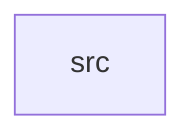

_Generated by CodeAtlas._

## Details

Owns 0 symbols across 1 file(s).

### src

Owns 187 symbols across 11 file(s).

**Related Classes/Methods:** _None_

**Source Files:**

- `crates/ai/src/adaptive_scheduling.rs`
  - `crates.ai.src.adaptive_scheduling.AdaptiveScheduler`
  - `crates.ai.src.adaptive_scheduling.AdaptiveScheduler.decide_scheduling`
  - `crates.ai.src.adaptive_scheduling.AdaptiveScheduler.get_decision`
  - `crates.ai.src.adaptive_scheduling.AdaptiveScheduler.get_metrics`
  - `crates.ai.src.adaptive_scheduling.AdaptiveScheduler.get_problematic_drivers`
  - `crates.ai.src.adaptive_scheduling.AdaptiveScheduler.get_stats`
  - `crates.ai.src.adaptive_scheduling.AdaptiveScheduler.get_strategy_distribution`
  - `crates.ai.src.adaptive_scheduling.AdaptiveScheduler.new`
  - `crates.ai.src.adaptive_scheduling.AdaptiveScheduler.record_slo_result`
  - `crates.ai.src.adaptive_scheduling.CPUAffinity`
  - `crates.ai.src.adaptive_scheduling.SchedulingDecision`
  - `crates.ai.src.adaptive_scheduling.SchedulingMetrics`
  - `crates.ai.src.adaptive_scheduling.SchedulingStats`
  - `crates.ai.src.adaptive_scheduling.SchedulingStrategy`
  - `crates.ai.src.adaptive_scheduling.WorkloadClassifier`
  - `crates.ai.src.adaptive_scheduling.WorkloadClassifier.classify`
  - `crates.ai.src.adaptive_scheduling.WorkloadClassifier.get_profile`
  - `crates.ai.src.adaptive_scheduling.WorkloadClassifier.new`
  - `crates.ai.src.adaptive_scheduling.WorkloadProfile`
  - `crates.ai.src.adaptive_scheduling.WorkloadType`
- `crates/ai/src/anomaly_detection.rs`
  - `crates.ai.src.anomaly_detection.Anomaly`
  - `crates.ai.src.anomaly_detection.AnomalyEngine`
  - `crates.ai.src.anomaly_detection.AnomalyEngine.add_anomaly`
  - `crates.ai.src.anomaly_detection.AnomalyEngine.get_anomalies_by_driver`
  - `crates.ai.src.anomaly_detection.AnomalyEngine.get_anomalies_by_type`
  - `crates.ai.src.anomaly_detection.AnomalyEngine.get_critical_anomalies`
  - `crates.ai.src.anomaly_detection.AnomalyEngine.get_stats`
  - `crates.ai.src.anomaly_detection.AnomalyEngine.new`
  - `crates.ai.src.anomaly_detection.AnomalyEngine.record_dma_operation`
  - `crates.ai.src.anomaly_detection.AnomalyEngine.record_interrupt`
  - `crates.ai.src.anomaly_detection.AnomalyEngine.record_memory_state`
  - `crates.ai.src.anomaly_detection.AnomalySeverity`
  - `crates.ai.src.anomaly_detection.AnomalyStats`
  - `crates.ai.src.anomaly_detection.AnomalyType`
  - `crates.ai.src.anomaly_detection.DmaAbuseDetector`
  - `crates.ai.src.anomaly_detection.DmaAbuseDetector.detect_abuse`
  - `crates.ai.src.anomaly_detection.DmaAbuseDetector.new`
  - `crates.ai.src.anomaly_detection.DmaAbuseDetector.record_dma`
  - `crates.ai.src.anomaly_detection.DmaOperation`
  - `crates.ai.src.anomaly_detection.InterruptStormDetector`
  - `crates.ai.src.anomaly_detection.InterruptStormDetector.detect_storm`
  - `crates.ai.src.anomaly_detection.InterruptStormDetector.new`
  - `crates.ai.src.anomaly_detection.InterruptStormDetector.record_interrupt`
  - `crates.ai.src.anomaly_detection.MemoryLeakDetector`
  - `crates.ai.src.anomaly_detection.MemoryLeakDetector.detect_leak`
  - `crates.ai.src.anomaly_detection.MemoryLeakDetector.new`
  - `crates.ai.src.anomaly_detection.MemoryLeakDetector.record_allocation`
  - `crates.ai.src.anomaly_detection.MemorySnapshot`
- `crates/ai/src/continuous_learning.rs`
  - `crates.ai.src.continuous_learning.ContinuousLearningEngine`
  - `crates.ai.src.continuous_learning.ContinuousLearningEngine.get_high_risk_drivers`
  - `crates.ai.src.continuous_learning.ContinuousLearningEngine.get_model`
  - `crates.ai.src.continuous_learning.ContinuousLearningEngine.get_optimization_stats`
  - `crates.ai.src.continuous_learning.ContinuousLearningEngine.get_stats`
  - `crates.ai.src.continuous_learning.ContinuousLearningEngine.new`
  - `crates.ai.src.continuous_learning.ContinuousLearningEngine.observe`
  - `crates.ai.src.continuous_learning.ContinuousLearningEngine.record_optimization`
  - `crates.ai.src.continuous_learning.DriverBehaviorModel`
  - `crates.ai.src.continuous_learning.DriverBehaviorModel.is_anomalous`
  - `crates.ai.src.continuous_learning.DriverBehaviorModel.new`
  - `crates.ai.src.continuous_learning.DriverBehaviorModel.observe`
  - `crates.ai.src.continuous_learning.DriverBehaviorModel.predict_cpu_usage`
  - `crates.ai.src.continuous_learning.DriverBehaviorModel.predict_memory_usage`
  - `crates.ai.src.continuous_learning.DriverBehaviorModel.recalculate_correlations`
  - `crates.ai.src.continuous_learning.DriverBehaviorModel.recalculate_trends`
  - `crates.ai.src.continuous_learning.LearningStats`
  - `crates.ai.src.continuous_learning.OptimizationResult`
  - `crates.ai.src.continuous_learning.OptimizationStats`
  - `crates.ai.src.continuous_learning.RuntimeObservation`
  - `crates.ai.src.continuous_learning.calculate_correlation`
- `crates/ai/src/inference.rs`
  - `crates.ai.src.inference.InferenceEngine`
  - `crates.ai.src.inference.InferenceEngine.load_model`
  - `crates.ai.src.inference.InferenceEngine.run_inference`
- `crates/ai/src/inference_engine.rs`
  - `crates.ai.src.inference_engine.FeatureVector`
  - `crates.ai.src.inference_engine.FeatureVector.from_context`
  - `crates.ai.src.inference_engine.FeatureVector.new`
  - `crates.ai.src.inference_engine.FeatureVector.norm`
  - `crates.ai.src.inference_engine.InferenceDecision`
  - `crates.ai.src.inference_engine.InferenceEngine`
  - `crates.ai.src.inference_engine.InferenceEngine.get_avg_latency`
  - `crates.ai.src.inference_engine.InferenceEngine.get_stats`
  - `crates.ai.src.inference_engine.InferenceEngine.infer`
  - `crates.ai.src.inference_engine.InferenceEngine.infer_anomaly_response`
  - `crates.ai.src.inference_engine.InferenceEngine.infer_optimization_action`
  - `crates.ai.src.inference_engine.InferenceEngine.infer_resource_allocation`
  - `crates.ai.src.inference_engine.InferenceEngine.infer_scheduling_strategy`
  - `crates.ai.src.inference_engine.InferenceEngine.new`
  - `crates.ai.src.inference_engine.InferenceRequest`
  - `crates.ai.src.inference_engine.InferenceStats`
  - `crates.ai.src.inference_engine.InferenceType`
- `crates/ai/src/monitoring.rs`
  - `crates.ai.src.monitoring.AiMonitor`
  - `crates.ai.src.monitoring.AiMonitor.default`
  - `crates.ai.src.monitoring.AiMonitor.detect_anomaly`
- `crates/ai/src/optimization.rs`
  - `crates.ai.src.optimization.ResourceOptimizer`
  - `crates.ai.src.optimization.ResourceOptimizer.optimize`
  - `crates.ai.src.optimization.ResourceOptimizer.predict_resource_needs`
- `crates/ai/src/predictive_allocation.rs`
  - `crates.ai.src.predictive_allocation.AffinityPreference`
  - `crates.ai.src.predictive_allocation.AllocationPattern`
  - `crates.ai.src.predictive_allocation.AllocationRecommendation`
  - `crates.ai.src.predictive_allocation.CpuPattern`
  - `crates.ai.src.predictive_allocation.IoPattern`
  - `crates.ai.src.predictive_allocation.IoSchedulingClass`
  - `crates.ai.src.predictive_allocation.IoSchedulingClass.from_io_rate`
  - `crates.ai.src.predictive_allocation.NetworkPattern`
  - `crates.ai.src.predictive_allocation.PredictionStats`
  - `crates.ai.src.predictive_allocation.PredictiveAllocator`
  - `crates.ai.src.predictive_allocation.PredictiveAllocator.get_allocation_recommendation`
  - `crates.ai.src.predictive_allocation.PredictiveAllocator.get_prediction_confidence`
  - `crates.ai.src.predictive_allocation.PredictiveAllocator.get_profiles_by_cpu_load`
  - `crates.ai.src.predictive_allocation.PredictiveAllocator.get_profiles_by_memory_usage`
  - `crates.ai.src.predictive_allocation.PredictiveAllocator.get_stats`
  - `crates.ai.src.predictive_allocation.PredictiveAllocator.new`
  - `crates.ai.src.predictive_allocation.PredictiveAllocator.predict_resources`
  - `crates.ai.src.predictive_allocation.PredictiveAllocator.update_profile`
  - `crates.ai.src.predictive_allocation.ResourceObservation`
  - `crates.ai.src.predictive_allocation.ResourcePrediction`
  - `crates.ai.src.predictive_allocation.ResourceProfile`
  - `crates.ai.src.predictive_allocation.TaskPriority`
- `crates/ai/src/reinforcement_learning.rs`
  - `crates.ai.src.reinforcement_learning.ActionPolicy`
  - `crates.ai.src.reinforcement_learning.ActionPolicy.new`
  - `crates.ai.src.reinforcement_learning.ActionPolicy.success_rate`
  - `crates.ai.src.reinforcement_learning.ActionPolicy.update`
  - `crates.ai.src.reinforcement_learning.DriverLearner`
  - `crates.ai.src.reinforcement_learning.DriverLearner.convergence_metric`
  - `crates.ai.src.reinforcement_learning.DriverLearner.get_best_action`
  - `crates.ai.src.reinforcement_learning.DriverLearner.get_top_actions`
  - `crates.ai.src.reinforcement_learning.DriverLearner.new`
  - `crates.ai.src.reinforcement_learning.DriverLearner.record_reward`
  - `crates.ai.src.reinforcement_learning.RLearningStats`
  - `crates.ai.src.reinforcement_learning.ReinforcementLearner`
  - `crates.ai.src.reinforcement_learning.ReinforcementLearner.get_best_actions_for_driver`
  - `crates.ai.src.reinforcement_learning.ReinforcementLearner.get_best_global_policy`
  - `crates.ai.src.reinforcement_learning.ReinforcementLearner.get_convergence_status`
  - `crates.ai.src.reinforcement_learning.ReinforcementLearner.get_stats`
  - `crates.ai.src.reinforcement_learning.ReinforcementLearner.new`
  - `crates.ai.src.reinforcement_learning.ReinforcementLearner.reward`
  - `crates.ai.src.reinforcement_learning.ReinforcementLearner.signal_to_reward`
  - `crates.ai.src.reinforcement_learning.RewardEvent`
  - `crates.ai.src.reinforcement_learning.RewardSignal`
- `crates/ai/src/tests.rs`
  - `crates.ai.src.tests.tests.test_action_policy_new`
  - `crates.ai.src.tests.tests.test_action_policy_update`
  - `crates.ai.src.tests.tests.test_adaptive_scheduler_new`
  - `crates.ai.src.tests.tests.test_allocation_priority_levels`
  - `crates.ai.src.tests.tests.test_allocation_recommendation`
  - `crates.ai.src.tests.tests.test_anomaly_detection_from_model`
  - `crates.ai.src.tests.tests.test_anomaly_engine_critical_detection`
  - `crates.ai.src.tests.tests.test_anomaly_engine_filter_by_type`
  - `crates.ai.src.tests.tests.test_anomaly_engine_memory_detection`
  - `crates.ai.src.tests.tests.test_anomaly_engine_new`
  - `crates.ai.src.tests.tests.test_anomaly_engine_statistics`
  - `crates.ai.src.tests.tests.test_anomaly_response_inference`
  - `crates.ai.src.tests.tests.test_behavior_model_observation`
  - `crates.ai.src.tests.tests.test_continuous_learning_observations`
  - `crates.ai.src.tests.tests.test_correlation_calculation`
  - `crates.ai.src.tests.tests.test_dma_abuse_detection`
  - `crates.ai.src.tests.tests.test_dma_abuse_detection_read_heavy_is_less_severe`
  - `crates.ai.src.tests.tests.test_dma_abuse_detector_new`
  - `crates.ai.src.tests.tests.test_driver_learner_convergence`
  - `crates.ai.src.tests.tests.test_driver_learner_new`
  - `crates.ai.src.tests.tests.test_driver_learner_reward`
  - `crates.ai.src.tests.tests.test_feature_vector_creation`
  - `crates.ai.src.tests.tests.test_inference_engine_new`
  - `crates.ai.src.tests.tests.test_inference_statistics`
  - `crates.ai.src.tests.tests.test_interrupt_storm_detection`
  - `crates.ai.src.tests.tests.test_interrupt_storm_detector_new`
  - `crates.ai.src.tests.tests.test_learning_engine_new`
  - `crates.ai.src.tests.tests.test_learning_stats`
  - `crates.ai.src.tests.tests.test_memory_leak_detection`
  - `crates.ai.src.tests.tests.test_memory_leak_detector_new`
  - `crates.ai.src.tests.tests.test_optimization_tracking`
  - `crates.ai.src.tests.tests.test_prediction`
  - `crates.ai.src.tests.tests.test_prediction_statistics`
  - `crates.ai.src.tests.tests.test_predictive_allocator_new`
  - `crates.ai.src.tests.tests.test_profile_learning`
  - `crates.ai.src.tests.tests.test_profile_sorting`
  - `crates.ai.src.tests.tests.test_reinforcement_learner_new`
  - `crates.ai.src.tests.tests.test_reinforcement_learner_policy_selection`
  - `crates.ai.src.tests.tests.test_reinforcement_learner_reward`
  - `crates.ai.src.tests.tests.test_reinforcement_learner_stats`
  - `crates.ai.src.tests.tests.test_resource_allocation_inference`
  - `crates.ai.src.tests.tests.test_reward_signal_conversion`
  - `crates.ai.src.tests.tests.test_scheduler_statistics`
  - `crates.ai.src.tests.tests.test_scheduling_strategy_inference`
  - `crates.ai.src.tests.tests.test_scheduling_strategy_selection`
  - `crates.ai.src.tests.tests.test_slo_tracking`
  - `crates.ai.src.tests.tests.test_trend_analysis`
  - `crates.ai.src.tests.tests.test_update_profile_memory`
  - `crates.ai.src.tests.tests.test_workload_classification`
