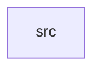

_Generated by CodeAtlas._

## Details

Owns 0 symbols across 1 file(s).

### src

Owns 42 symbols across 1 file(s).

**Related Classes/Methods:** _None_

**Source Files:**

- `crates/audio_driver/src/lib.rs`
  - `crates.audio_driver.src.lib.AudioBuffer`
  - `crates.audio_driver.src.lib.AudioDevice`
  - `crates.audio_driver.src.lib.AudioDriver`
  - `crates.audio_driver.src.lib.AudioDriver.allocate_buffer`
  - `crates.audio_driver.src.lib.AudioDriver.buffer_count`
  - `crates.audio_driver.src.lib.AudioDriver.default`
  - `crates.audio_driver.src.lib.AudioDriver.device_count`
  - `crates.audio_driver.src.lib.AudioDriver.free_buffer`
  - `crates.audio_driver.src.lib.AudioDriver.get_active_stream_count`
  - `crates.audio_driver.src.lib.AudioDriver.get_buffer`
  - `crates.audio_driver.src.lib.AudioDriver.get_device`
  - `crates.audio_driver.src.lib.AudioDriver.get_devices_by_role`
  - `crates.audio_driver.src.lib.AudioDriver.get_playback_devices`
  - `crates.audio_driver.src.lib.AudioDriver.get_recording_devices`
  - `crates.audio_driver.src.lib.AudioDriver.get_volume`
  - `crates.audio_driver.src.lib.AudioDriver.new`
  - `crates.audio_driver.src.lib.AudioDriver.read_buffer`
  - `crates.audio_driver.src.lib.AudioDriver.register_device`
  - `crates.audio_driver.src.lib.AudioDriver.set_format`
  - `crates.audio_driver.src.lib.AudioDriver.set_mute`
  - `crates.audio_driver.src.lib.AudioDriver.set_sample_rate`
  - `crates.audio_driver.src.lib.AudioDriver.set_volume`
  - `crates.audio_driver.src.lib.AudioDriver.start_stream`
  - `crates.audio_driver.src.lib.AudioDriver.stop_stream`
  - `crates.audio_driver.src.lib.AudioDriver.write_buffer`
  - `crates.audio_driver.src.lib.AudioFormat`
  - `crates.audio_driver.src.lib.DeviceRole`
  - `crates.audio_driver.src.lib.VolumeControl`
  - `crates.audio_driver.src.lib.tests.test_allocate_buffer`
  - `crates.audio_driver.src.lib.tests.test_audio_driver_creation`
  - `crates.audio_driver.src.lib.tests.test_buffer_write_read`
  - `crates.audio_driver.src.lib.tests.test_get_playback_devices`
  - `crates.audio_driver.src.lib.tests.test_get_recording_devices`
  - `crates.audio_driver.src.lib.tests.test_multiple_devices`
  - `crates.audio_driver.src.lib.tests.test_register_playback_device`
  - `crates.audio_driver.src.lib.tests.test_set_format`
  - `crates.audio_driver.src.lib.tests.test_set_mute`
  - `crates.audio_driver.src.lib.tests.test_set_sample_rate`
  - `crates.audio_driver.src.lib.tests.test_set_volume`
  - `crates.audio_driver.src.lib.tests.test_start_stop_stream`
  - `crates.audio_driver.src.lib.tests.test_unsupported_sample_rate`
  - `crates.audio_driver.src.lib.tests.test_volume_out_of_range`
