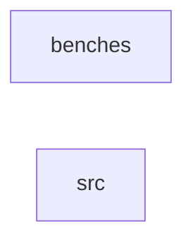

_Generated by CodeAtlas._

## Details

Owns 0 symbols across 1 file(s).

### benches

Owns 20 symbols across 4 file(s).

**Related Classes/Methods:** _None_

**Source Files:**

- `crates/benchmarks/benches/device_enumeration.rs`
  - `crates.benchmarks.benches.device_enumeration.benchmark_device_enumeration`
  - `crates.benchmarks.benches.device_enumeration.benchmark_device_lookup`
  - `crates.benchmarks.benches.device_enumeration.benchmark_device_registration`
  - `crates.benchmarks.benches.device_enumeration.benchmark_driver_matching`
  - `crates.benchmarks.benches.device_enumeration.make_device`
- `crates/benchmarks/benches/lki_translation.rs`
  - `crates.benchmarks.benches.lki_translation.benchmark_kfree_translation`
  - `crates.benchmarks.benches.lki_translation.benchmark_kmalloc_sizes`
  - `crates.benchmarks.benches.lki_translation.benchmark_kmalloc_translation`
  - `crates.benchmarks.benches.lki_translation.benchmark_request_irq_translation`
  - `crates.benchmarks.benches.lki_translation.benchmark_validation_overhead`
- `crates/benchmarks/benches/memory_allocation.rs`
  - `crates.benchmarks.benches.memory_allocation.benchmark_allocation_sequence`
  - `crates.benchmarks.benches.memory_allocation.benchmark_large_allocation`
  - `crates.benchmarks.benches.memory_allocation.benchmark_small_allocation`
  - `crates.benchmarks.benches.memory_allocation.linux_baseline_comparison`
- `crates/benchmarks/benches/security_checks.rs`
  - `crates.benchmarks.benches.security_checks.benchmark_audit_logging`
  - `crates.benchmarks.benches.security_checks.benchmark_capability_check`
  - `crates.benchmarks.benches.security_checks.benchmark_capability_check_miss`
  - `crates.benchmarks.benches.security_checks.benchmark_expiration_check`
  - `crates.benchmarks.benches.security_checks.benchmark_multiple_capability_checks`
  - `crates.benchmarks.benches.security_checks.setup_enforcer_with_grant`

### src

Owns 7 symbols across 1 file(s).

**Related Classes/Methods:** _None_

**Source Files:**

- `crates/benchmarks/src/lib.rs`
  - `crates.benchmarks.src.lib.BenchmarkMetrics`
  - `crates.benchmarks.src.lib.BenchmarkMetrics.fmt`
  - `crates.benchmarks.src.lib.BenchmarkMetrics.new`
  - `crates.benchmarks.src.lib.BenchmarkMetrics.to_microseconds`
  - `crates.benchmarks.src.lib.ComparisonRow`
  - `crates.benchmarks.src.lib.ComparisonRow.to_markdown`
  - `crates.benchmarks.src.lib.calculate_overhead`
