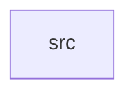

_Generated by CodeAtlas._

## Details

Owns 0 symbols across 1 file(s).

### src

Owns 42 symbols across 6 file(s).

**Related Classes/Methods:** _None_

**Source Files:**

- `crates/bootstrap/src/cpu.rs`
  - `crates.bootstrap.src.cpu.CpuInfo`
  - `crates.bootstrap.src.cpu.get_info`
  - `crates.bootstrap.src.cpu.initialize`
  - `crates.bootstrap.src.cpu.tests.get_info_reports_real_cpu_count`
  - `crates.bootstrap.src.cpu.tests.initialize_never_fails`
- `crates/bootstrap/src/heap.rs`
  - `crates.bootstrap.src.heap.HeapState`
  - `crates.bootstrap.src.heap.HeapState.bump`
  - `crates.bootstrap.src.heap.HeapState.new`
  - `crates.bootstrap.src.heap.HeapState.remaining`
  - `crates.bootstrap.src.heap.HeapState.used`
  - `crates.bootstrap.src.heap.initialize`
  - `crates.bootstrap.src.heap.tests.bump_allocates_sequentially`
  - `crates.bootstrap.src.heap.tests.bump_beyond_capacity_errors`
  - `crates.bootstrap.src.heap.tests.initialize_returns_empty_heap_of_requested_capacity`
- `crates/bootstrap/src/lib.rs`
  - `crates.bootstrap.src.lib.Bootstrap`
  - `crates.bootstrap.src.lib.Bootstrap.boot_time_ms`
  - `crates.bootstrap.src.lib.Bootstrap.execute`
  - `crates.bootstrap.src.lib.Bootstrap.heap`
  - `crates.bootstrap.src.lib.Bootstrap.new`
  - `crates.bootstrap.src.lib.BootstrapConfig`
  - `crates.bootstrap.src.lib.BootstrapConfig.default`
  - `crates.bootstrap.src.lib.tests.execute_completes_and_records_heap_state`
  - `crates.bootstrap.src.lib.tests.execute_skips_verification_when_disabled`
- `crates/bootstrap/src/memory_map.rs`
  - `crates.bootstrap.src.memory_map.MemoryRegion`
  - `crates.bootstrap.src.memory_map.MemoryRegion.end`
  - `crates.bootstrap.src.memory_map.discover`
  - `crates.bootstrap.src.memory_map.regions_are_disjoint`
  - `crates.bootstrap.src.memory_map.tests.discover_includes_bios_and_ram`
  - `crates.bootstrap.src.memory_map.tests.discover_returns_disjoint_regions`
  - `crates.bootstrap.src.memory_map.tests.overlapping_regions_detected_as_not_disjoint`
- `crates/bootstrap/src/mmu.rs`
  - `crates.bootstrap.src.mmu.setup`
  - `crates.bootstrap.src.mmu.tests.region`
  - `crates.bootstrap.src.mmu.tests.setup_accepts_disjoint_regions`
  - `crates.bootstrap.src.mmu.tests.setup_rejects_empty_map`
  - `crates.bootstrap.src.mmu.tests.setup_rejects_overlapping_regions`
- `crates/bootstrap/src/verification.rs`
  - `crates.bootstrap.src.verification.checksum`
  - `crates.bootstrap.src.verification.tests.different_images_produce_different_checksums`
  - `crates.bootstrap.src.verification.tests.matching_checksum_verifies`
  - `crates.bootstrap.src.verification.tests.mismatched_checksum_fails`
  - `crates.bootstrap.src.verification.tests.placeholder_root_image_always_verifies`
  - `crates.bootstrap.src.verification.verify_image`
  - `crates.bootstrap.src.verification.verify_root_image`
