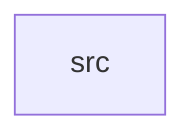

_Generated by CodeAtlas._

## Details

Owns 0 symbols across 1 file(s).

### src

Owns 21 symbols across 3 file(s).

**Related Classes/Methods:** _None_

**Source Files:**

- `crates/common/src/error.rs`
  - `crates.common.src.error.Error`
  - `crates.common.src.error.tests.error_messages_include_context`
  - `crates.common.src.error.tests.io_error_converts_via_from`
  - `crates.common.src.error.tests.ipc_error_includes_context`
  - `crates.common.src.error.tests.out_of_memory_has_fixed_message`
- `crates/common/src/types.rs`
  - `crates.common.src.types.Capability`
  - `crates.common.src.types.ObjectId`
  - `crates.common.src.types.ObjectId.default`
  - `crates.common.src.types.ObjectId.fmt`
  - `crates.common.src.types.ObjectId.new`
  - `crates.common.src.types.ObjectId.nil`
  - `crates.common.src.types.ObjectType`
  - `crates.common.src.types.ObjectType.fmt`
  - `crates.common.src.types.PermissionTier`
  - `crates.common.src.types.tests.capability_values_are_distinct_bitflags`
  - `crates.common.src.types.tests.object_id_default_is_unique_each_call`
  - `crates.common.src.types.tests.object_id_display_matches_uuid_format`
  - `crates.common.src.types.tests.object_id_new_generates_unique_nonzero_ids`
  - `crates.common.src.types.tests.object_id_nil_is_stable`
  - `crates.common.src.types.tests.object_type_display_is_human_readable`
  - `crates.common.src.types.tests.permission_tiers_are_hashable_and_distinct`
