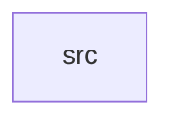

_Generated by CodeAtlas._

## Details

Owns 0 symbols across 1 file(s).

### src

Owns 18 symbols across 3 file(s).

**Related Classes/Methods:** _None_

**Source Files:**

- `crates/compatibility/src/linux.rs`
  - `crates.compatibility.src.linux.SherTarget`
  - `crates.compatibility.src.linux.is_supported`
  - `crates.compatibility.src.linux.supported_apis`
  - `crates.compatibility.src.linux.tests.known_irq_apis_translate_to_interrupt_controller`
  - `crates.compatibility.src.linux.tests.known_memory_apis_translate_to_memory_allocator`
  - `crates.compatibility.src.linux.tests.supported_apis_are_sorted_and_nonempty`
  - `crates.compatibility.src.linux.tests.unknown_api_returns_none`
  - `crates.compatibility.src.linux.translate`
  - `crates.compatibility.src.linux.translation_table`
- `crates/compatibility/src/posix.rs`
  - `crates.compatibility.src.posix.SherTarget`
  - `crates.compatibility.src.posix.is_supported`
  - `crates.compatibility.src.posix.supported_calls`
  - `crates.compatibility.src.posix.tests.file_calls_translate_to_storage`
  - `crates.compatibility.src.posix.tests.memory_calls_translate_to_memory_allocator`
  - `crates.compatibility.src.posix.tests.socket_calls_translate_to_networking`
  - `crates.compatibility.src.posix.tests.unknown_call_is_unsupported`
  - `crates.compatibility.src.posix.translate`
  - `crates.compatibility.src.posix.translation_table`
