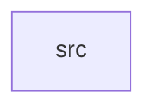

_Generated by CodeAtlas._

## Details

Owns 0 symbols across 1 file(s).

### src

Owns 41 symbols across 6 file(s).

**Related Classes/Methods:** _None_

**Source Files:**

- `crates/compute/src/cpu.rs`
  - `crates.compute.src.cpu.CpuScheduler`
  - `crates.compute.src.cpu.CpuScheduler.completed`
  - `crates.compute.src.cpu.CpuScheduler.new`
  - `crates.compute.src.cpu.CpuScheduler.pending`
  - `crates.compute.src.cpu.CpuScheduler.schedule`
  - `crates.compute.src.cpu.CpuScheduler.submit`
  - `crates.compute.src.cpu.tests.schedule_dispatches_highest_priority_job`
  - `crates.compute.src.cpu.tests.schedule_on_empty_queue_returns_none`
- `crates/compute/src/dsp.rs`
  - `crates.compute.src.dsp.DspScheduler`
  - `crates.compute.src.dsp.DspScheduler.completed`
  - `crates.compute.src.dsp.DspScheduler.new`
  - `crates.compute.src.dsp.DspScheduler.pending`
  - `crates.compute.src.dsp.DspScheduler.schedule`
  - `crates.compute.src.dsp.DspScheduler.submit`
  - `crates.compute.src.dsp.tests.schedule_dispatches_highest_priority_job`
- `crates/compute/src/gpu.rs`
  - `crates.compute.src.gpu.GpuScheduler`
  - `crates.compute.src.gpu.GpuScheduler.completed`
  - `crates.compute.src.gpu.GpuScheduler.new`
  - `crates.compute.src.gpu.GpuScheduler.pending`
  - `crates.compute.src.gpu.GpuScheduler.schedule`
  - `crates.compute.src.gpu.GpuScheduler.submit`
  - `crates.compute.src.gpu.tests.schedule_dispatches_highest_priority_job`
- `crates/compute/src/npu.rs`
  - `crates.compute.src.npu.NpuScheduler`
  - `crates.compute.src.npu.NpuScheduler.completed`
  - `crates.compute.src.npu.NpuScheduler.new`
  - `crates.compute.src.npu.NpuScheduler.pending`
  - `crates.compute.src.npu.NpuScheduler.schedule`
  - `crates.compute.src.npu.NpuScheduler.submit`
  - `crates.compute.src.npu.tests.schedule_dispatches_highest_priority_job`
- `crates/compute/src/queue.rs`
  - `crates.compute.src.queue.Job`
  - `crates.compute.src.queue.Job.new`
  - `crates.compute.src.queue.WorkQueue`
  - `crates.compute.src.queue.WorkQueue.completed`
  - `crates.compute.src.queue.WorkQueue.drain_all`
  - `crates.compute.src.queue.WorkQueue.new`
  - `crates.compute.src.queue.WorkQueue.pending`
  - `crates.compute.src.queue.WorkQueue.run_next`
  - `crates.compute.src.queue.WorkQueue.submit`
  - `crates.compute.src.queue.tests.completed_counter_tracks_dispatches`
  - `crates.compute.src.queue.tests.drain_all_returns_priority_order`
  - `crates.compute.src.queue.tests.run_next_respects_priority`
