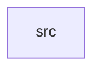

_Generated by CodeAtlas._

## Details

Owns 0 symbols across 1 file(s).

### src

Owns 67 symbols across 6 file(s).

**Related Classes/Methods:** _None_

**Source Files:**

- `crates/core/src/capability_manager.rs`
  - `crates.core.src.capability_manager.CapabilityManager`
  - `crates.core.src.capability_manager.CapabilityManager.cleanup_expired`
  - `crates.core.src.capability_manager.CapabilityManager.enforce`
  - `crates.core.src.capability_manager.CapabilityManager.grant`
  - `crates.core.src.capability_manager.CapabilityManager.new`
  - `crates.core.src.capability_manager.CapabilityManager.revoke`
  - `crates.core.src.capability_manager.initialize`
  - `crates.core.src.capability_manager.tests.enforce_denies_by_default`
  - `crates.core.src.capability_manager.tests.grant_then_enforce_succeeds`
  - `crates.core.src.capability_manager.tests.revoke_removes_access`
- `crates/core/src/cpu_scheduler.rs`
  - `crates.core.src.cpu_scheduler.BasicCpuScheduler`
  - `crates.core.src.cpu_scheduler.BasicCpuScheduler.enqueue`
  - `crates.core.src.cpu_scheduler.BasicCpuScheduler.new`
  - `crates.core.src.cpu_scheduler.BasicCpuScheduler.ready_count`
  - `crates.core.src.cpu_scheduler.BasicCpuScheduler.run_next`
  - `crates.core.src.cpu_scheduler.BasicCpuScheduler.running`
  - `crates.core.src.cpu_scheduler.initialize`
  - `crates.core.src.cpu_scheduler.tests.fifo_ordering_is_respected`
  - `crates.core.src.cpu_scheduler.tests.round_robin_requeues_previous_task`
  - `crates.core.src.cpu_scheduler.tests.run_next_on_empty_queue_returns_none`
- `crates/core/src/ipc.rs`
  - `crates.core.src.ipc.IpcBus`
  - `crates.core.src.ipc.IpcBus.capacity`
  - `crates.core.src.ipc.IpcBus.mailbox_handle`
  - `crates.core.src.ipc.IpcBus.new`
  - `crates.core.src.ipc.IpcBus.pending_count`
  - `crates.core.src.ipc.IpcBus.receive`
  - `crates.core.src.ipc.IpcBus.register_mailbox`
  - `crates.core.src.ipc.IpcBus.register_mailbox_with_capacity`
  - `crates.core.src.ipc.IpcBus.send`
  - `crates.core.src.ipc.Message`
  - `crates.core.src.ipc.initialize`
  - `crates.core.src.ipc.tests.mailbox_is_a_bounded_ring_buffer_not_unbounded`
  - `crates.core.src.ipc.tests.pending_count_tracks_queue_depth`
  - `crates.core.src.ipc.tests.send_and_receive_are_zero_copy`
  - `crates.core.src.ipc.tests.send_and_receive_is_fifo`
  - `crates.core.src.ipc.tests.send_and_receive_work_through_shared_ref_across_threads`
  - `crates.core.src.ipc.tests.send_to_unregistered_mailbox_errors`
- `crates/core/src/lib.rs`
  - `crates.core.src.lib.CoreKernel`
  - `crates.core.src.lib.CoreKernel.initialize`
  - `crates.core.src.lib.tests.initialize_wires_up_all_subsystems`
- `crates/core/src/object_manager.rs`
  - `crates.core.src.object_manager.ObjectManager`
  - `crates.core.src.object_manager.ObjectManager.create`
  - `crates.core.src.object_manager.ObjectManager.create_root`
  - `crates.core.src.object_manager.ObjectManager.get`
  - `crates.core.src.object_manager.ObjectManager.get_mut`
  - `crates.core.src.object_manager.ObjectManager.is_empty`
  - `crates.core.src.object_manager.ObjectManager.len`
  - `crates.core.src.object_manager.ObjectManager.new`
  - `crates.core.src.object_manager.ObjectManager.remove`
  - `crates.core.src.object_manager.ObjectManager.root`
  - `crates.core.src.object_manager.initialize`
  - `crates.core.src.object_manager.tests.create_and_get_object`
  - `crates.core.src.object_manager.tests.create_root_is_idempotent`
  - `crates.core.src.object_manager.tests.initialize_creates_root`
  - `crates.core.src.object_manager.tests.removing_lone_root_succeeds`
  - `crates.core.src.object_manager.tests.removing_root_with_dependents_is_rejected`
- `crates/core/src/timer.rs`
  - `crates.core.src.timer.TimerEntry`
  - `crates.core.src.timer.TimerWheel`
  - `crates.core.src.timer.TimerWheel.cancel`
  - `crates.core.src.timer.TimerWheel.new`
  - `crates.core.src.timer.TimerWheel.pending_count`
  - `crates.core.src.timer.TimerWheel.poll`
  - `crates.core.src.timer.TimerWheel.schedule`
  - `crates.core.src.timer.initialize`
  - `crates.core.src.timer.tests.cancel_removes_pending_timer`
  - `crates.core.src.timer.tests.poll_at_exact_deadline_fires`
  - `crates.core.src.timer.tests.poll_returns_only_due_entries_in_order`
