```mermaid
graph LR
    ai["ai"]
    aro["aro"]
    audio_driver["audio_driver"]
    benchmarks["benchmarks"]
    bootstrap["bootstrap"]
    common["common"]
    compatibility["compatibility"]
    compute["compute"]
    core["core"]
    device_manager["device_manager"]
    diagnostics["diagnostics"]
    digital_twins["digital_twins"]
    driver_runtime["driver_runtime"]
    drivers["drivers"]
    gpu_driver["gpu_driver"]
    hal["hal"]
    hardening["hardening"]
    input_driver["input_driver"]
    interrupt["interrupt"]
    kernel["kernel"]
    lki["lki"]
    memory["memory"]
    networking["networking"]
    objectmodel["objectmodel"]
    performance_benchmarks["performance_benchmarks"]
    performance_optimization["performance_optimization"]
    profiling["profiling"]
    recovery["recovery"]
    release_engineering["release_engineering"]
    runtime["runtime"]
    scheduler["scheduler"]
    security["security"]
    security_audit["security_audit"]
    services["services"]
    snapshot["snapshot"]
    storage["storage"]
    system_integration["system_integration"]
    unified_device_manager["unified_device_manager"]
    updater["updater"]
    wayland_server["wayland_server"]
    ai -- "calls" --> diagnostics
    ai -- "calls" --> driver_runtime
    ai -- "calls" --> memory
    ai -- "calls" --> core
    device_manager -- "calls" --> diagnostics
    device_manager -- "calls" --> driver_runtime
    device_manager -- "calls" --> memory
    device_manager -- "calls" --> core
    diagnostics -- "calls" --> memory
    digital_twins -- "calls" --> diagnostics
    digital_twins -- "calls" --> lki
    digital_twins -- "calls" --> memory
    driver_runtime -- "calls" --> diagnostics
    driver_runtime -- "calls" --> memory
    driver_runtime -- "calls" --> core
    drivers -- "calls" --> diagnostics
    drivers -- "calls" --> memory
    drivers -- "calls" --> core
    gpu_driver -- "calls" --> core
    hal -- "calls" --> diagnostics
    hardening -- "calls" --> diagnostics
    hardening -- "calls" --> memory
    hardening -- "calls" --> core
    input_driver -- "calls" --> diagnostics
    input_driver -- "calls" --> core
    interrupt -- "calls" --> diagnostics
    interrupt -- "calls" --> memory
    interrupt -- "calls" --> core
    kernel -- "calls" --> ai
    kernel -- "calls" --> device_manager
    kernel -- "calls" --> memory
    kernel -- "calls" --> common
    lki -- "calls" --> diagnostics
    lki -- "calls" --> driver_runtime
    lki -- "calls" --> memory
    lki -- "calls" --> core
    memory -- "calls" --> diagnostics
    memory -- "calls" --> performance_optimization
    memory -- "calls" --> services
    memory -- "calls" --> core
    networking -- "calls" --> memory
    networking -- "calls" --> core
    objectmodel -- "calls" --> diagnostics
    performance_benchmarks -- "calls" --> diagnostics
    performance_benchmarks -- "calls" --> driver_runtime
    performance_benchmarks -- "calls" --> gpu_driver
    performance_benchmarks -- "calls" --> memory
    performance_benchmarks -- "calls" --> system_integration
    performance_benchmarks -- "calls" --> wayland_server
    performance_optimization -- "calls" --> diagnostics
    performance_optimization -- "calls" --> core
    profiling -- "calls" --> diagnostics
    profiling -- "calls" --> driver_runtime
    profiling -- "calls" --> lki
    profiling -- "calls" --> memory
    profiling -- "calls" --> services
    profiling -- "calls" --> core
    recovery -- "calls" --> diagnostics
    recovery -- "calls" --> driver_runtime
    recovery -- "calls" --> memory
    recovery -- "calls" --> core
    release_engineering -- "calls" --> diagnostics
    release_engineering -- "calls" --> memory
    audio_driver -- "calls" --> core
    runtime -- "calls" --> diagnostics
    scheduler -- "calls" --> diagnostics
    scheduler -- "calls" --> memory
    scheduler -- "calls" --> core
    security -- "calls" --> diagnostics
    security_audit -- "calls" --> diagnostics
    security_audit -- "calls" --> memory
    security_audit -- "calls" --> core
    snapshot -- "calls" --> diagnostics
    snapshot -- "calls" --> memory
    storage -- "calls" --> memory
    storage -- "calls" --> core
    system_integration -- "calls" --> gpu_driver
    system_integration -- "calls" --> input_driver
    system_integration -- "calls" --> unified_device_manager
    system_integration -- "calls" --> wayland_server
    unified_device_manager -- "calls" --> diagnostics
    unified_device_manager -- "calls" --> driver_runtime
    updater -- "calls" --> diagnostics
    updater -- "calls" --> memory
    updater -- "calls" --> recovery
    benchmarks -- "calls" --> device_manager
    benchmarks -- "calls" --> diagnostics
    benchmarks -- "calls" --> lki
    benchmarks -- "calls" --> memory
    wayland_server -- "calls" --> core
    bootstrap -- "calls" --> diagnostics
    common -- "calls" --> diagnostics
    common -- "calls" --> memory
    compute -- "calls" --> diagnostics
    compute -- "calls" --> memory
    compute -- "calls" --> core
    core -- "calls" --> diagnostics
    core -- "calls" --> lki
    core -- "calls" --> memory
    click ai href "./ai.md" "Details"
    click aro href "./aro.md" "Details"
    click audio_driver href "./audio_driver.md" "Details"
    click benchmarks href "./benchmarks.md" "Details"
    click bootstrap href "./bootstrap.md" "Details"
    click common href "./common.md" "Details"
    click compatibility href "./compatibility.md" "Details"
    click compute href "./compute.md" "Details"
    click core href "./core.md" "Details"
    click device_manager href "./device_manager.md" "Details"
    click diagnostics href "./diagnostics.md" "Details"
    click digital_twins href "./digital_twins.md" "Details"
    click driver_runtime href "./driver_runtime.md" "Details"
    click drivers href "./drivers.md" "Details"
    click gpu_driver href "./gpu_driver.md" "Details"
    click hal href "./hal.md" "Details"
    click hardening href "./hardening.md" "Details"
    click input_driver href "./input_driver.md" "Details"
    click interrupt href "./interrupt.md" "Details"
    click kernel href "./kernel.md" "Details"
    click lki href "./lki.md" "Details"
    click memory href "./memory.md" "Details"
    click networking href "./networking.md" "Details"
    click objectmodel href "./objectmodel.md" "Details"
    click performance_benchmarks href "./performance_benchmarks.md" "Details"
    click performance_optimization href "./performance_optimization.md" "Details"
    click profiling href "./profiling.md" "Details"
    click recovery href "./recovery.md" "Details"
    click release_engineering href "./release_engineering.md" "Details"
    click runtime href "./runtime.md" "Details"
    click scheduler href "./scheduler.md" "Details"
    click security href "./security.md" "Details"
    click security_audit href "./security_audit.md" "Details"
    click services href "./services.md" "Details"
    click snapshot href "./snapshot.md" "Details"
    click storage href "./storage.md" "Details"
    click system_integration href "./system_integration.md" "Details"
    click unified_device_manager href "./unified_device_manager.md" "Details"
    click updater href "./updater.md" "Details"
    click wayland_server href "./wayland_server.md" "Details"
```

_Generated by CodeAtlas._

## Details

Owns 0 symbols across 0 file(s).

### ai

Owns 0 symbols across 1 file(s).

**Related Classes/Methods:** _None_

### aro

Owns 0 symbols across 1 file(s).

**Related Classes/Methods:** _None_

### audio_driver

Owns 0 symbols across 1 file(s).

**Related Classes/Methods:** _None_

### benchmarks

Owns 0 symbols across 1 file(s).

**Related Classes/Methods:** _None_

### bootstrap

Owns 0 symbols across 1 file(s).

**Related Classes/Methods:** _None_

### common

Owns 0 symbols across 1 file(s).

**Related Classes/Methods:** _None_

### compatibility

Owns 0 symbols across 1 file(s).

**Related Classes/Methods:** _None_

### compute

Owns 0 symbols across 1 file(s).

**Related Classes/Methods:** _None_

### core

Owns 0 symbols across 1 file(s).

**Related Classes/Methods:** _None_

### device_manager

Owns 0 symbols across 1 file(s).

**Related Classes/Methods:** _None_

### diagnostics

Owns 0 symbols across 1 file(s).

**Related Classes/Methods:** _None_

### digital_twins

Owns 0 symbols across 1 file(s).

**Related Classes/Methods:** _None_

### driver_runtime

Owns 0 symbols across 1 file(s).

**Related Classes/Methods:** _None_

### drivers

Owns 0 symbols across 1 file(s).

**Related Classes/Methods:** _None_

### gpu_driver

Owns 0 symbols across 1 file(s).

**Related Classes/Methods:** _None_

### hal

Owns 0 symbols across 1 file(s).

**Related Classes/Methods:** _None_

### hardening

Owns 0 symbols across 1 file(s).

**Related Classes/Methods:** _None_

### input_driver

Owns 0 symbols across 1 file(s).

**Related Classes/Methods:** _None_

### interrupt

Owns 0 symbols across 1 file(s).

**Related Classes/Methods:** _None_

### kernel

Owns 0 symbols across 1 file(s).

**Related Classes/Methods:** _None_

### lki

Owns 0 symbols across 1 file(s).

**Related Classes/Methods:** _None_

### memory

Owns 0 symbols across 1 file(s).

**Related Classes/Methods:** _None_

### networking

Owns 0 symbols across 1 file(s).

**Related Classes/Methods:** _None_

### objectmodel

Owns 0 symbols across 1 file(s).

**Related Classes/Methods:** _None_

### performance_benchmarks

Owns 0 symbols across 1 file(s).

**Related Classes/Methods:** _None_

### performance_optimization

Owns 0 symbols across 1 file(s).

**Related Classes/Methods:** _None_

### profiling

Owns 0 symbols across 1 file(s).

**Related Classes/Methods:** _None_

### recovery

Owns 0 symbols across 1 file(s).

**Related Classes/Methods:** _None_

### release_engineering

Owns 0 symbols across 1 file(s).

**Related Classes/Methods:** _None_

### runtime

Owns 0 symbols across 1 file(s).

**Related Classes/Methods:** _None_

### scheduler

Owns 0 symbols across 1 file(s).

**Related Classes/Methods:** _None_

### security

Owns 0 symbols across 1 file(s).

**Related Classes/Methods:** _None_

### security_audit

Owns 0 symbols across 1 file(s).

**Related Classes/Methods:** _None_

### services

Owns 0 symbols across 1 file(s).

**Related Classes/Methods:** _None_

### snapshot

Owns 0 symbols across 1 file(s).

**Related Classes/Methods:** _None_

### storage

Owns 0 symbols across 1 file(s).

**Related Classes/Methods:** _None_

### system_integration

Owns 0 symbols across 1 file(s).

**Related Classes/Methods:** _None_

### unified_device_manager

Owns 0 symbols across 1 file(s).

**Related Classes/Methods:** _None_

### updater

Owns 0 symbols across 1 file(s).

**Related Classes/Methods:** _None_

### wayland_server

Owns 0 symbols across 1 file(s).

**Related Classes/Methods:** _None_
