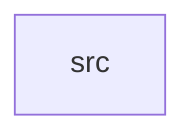

_Generated by CodeAtlas._

## Details

Owns 0 symbols across 1 file(s).

### src

Owns 35 symbols across 3 file(s).

**Related Classes/Methods:** _None_

**Source Files:**

- `crates/diagnostics/src/ringbuffer.rs`
  - `crates.diagnostics.src.ringbuffer.RingBuffer`
  - `crates.diagnostics.src.ringbuffer.RingBuffer.capacity`
  - `crates.diagnostics.src.ringbuffer.RingBuffer.clear`
  - `crates.diagnostics.src.ringbuffer.RingBuffer.default`
  - `crates.diagnostics.src.ringbuffer.RingBuffer.drain`
  - `crates.diagnostics.src.ringbuffer.RingBuffer.is_empty`
  - `crates.diagnostics.src.ringbuffer.RingBuffer.is_full`
  - `crates.diagnostics.src.ringbuffer.RingBuffer.iter`
  - `crates.diagnostics.src.ringbuffer.RingBuffer.len`
  - `crates.diagnostics.src.ringbuffer.RingBuffer.new`
  - `crates.diagnostics.src.ringbuffer.RingBuffer.newest`
  - `crates.diagnostics.src.ringbuffer.RingBuffer.oldest`
  - `crates.diagnostics.src.ringbuffer.RingBuffer.push`
  - `crates.diagnostics.src.ringbuffer.RingBuffer.with_capacity`
  - `crates.diagnostics.src.ringbuffer.tests.default_capacity_matches_constant`
  - `crates.diagnostics.src.ringbuffer.tests.drain_empties_buffer_oldest_first`
  - `crates.diagnostics.src.ringbuffer.tests.oldest_and_newest_track_correctly`
  - `crates.diagnostics.src.ringbuffer.tests.push_beyond_capacity_evicts_oldest`
  - `crates.diagnostics.src.ringbuffer.tests.push_within_capacity_keeps_all_entries`
  - `crates.diagnostics.src.ringbuffer.tests.zero_capacity_panics`
- `crates/diagnostics/src/telemetry.rs`
  - `crates.diagnostics.src.telemetry.Telemetry`
  - `crates.diagnostics.src.telemetry.Telemetry.average`
  - `crates.diagnostics.src.telemetry.Telemetry.counter`
  - `crates.diagnostics.src.telemetry.Telemetry.counters_snapshot`
  - `crates.diagnostics.src.telemetry.Telemetry.events`
  - `crates.diagnostics.src.telemetry.Telemetry.gauge`
  - `crates.diagnostics.src.telemetry.Telemetry.increment`
  - `crates.diagnostics.src.telemetry.Telemetry.new`
  - `crates.diagnostics.src.telemetry.Telemetry.record_event`
  - `crates.diagnostics.src.telemetry.Telemetry.set_gauge`
  - `crates.diagnostics.src.telemetry.TelemetryEvent`
  - `crates.diagnostics.src.telemetry.tests.counters_accumulate`
  - `crates.diagnostics.src.telemetry.tests.counters_snapshot_is_independent_copy`
  - `crates.diagnostics.src.telemetry.tests.events_recorded_and_averaged`
  - `crates.diagnostics.src.telemetry.tests.gauges_overwrite`
