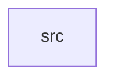

_Generated by CodeAtlas._

## Details

Owns 0 symbols across 1 file(s).

### src

Owns 50 symbols across 3 file(s).

**Related Classes/Methods:** _None_

**Source Files:**

- `crates/digital_twins/src/event_log.rs`
  - `crates.digital_twins.src.event_log.EventLog`
  - `crates.digital_twins.src.event_log.EventLog.clear`
  - `crates.digital_twins.src.event_log.EventLog.current_time`
  - `crates.digital_twins.src.event_log.EventLog.disable`
  - `crates.digital_twins.src.event_log.EventLog.enable`
  - `crates.digital_twins.src.event_log.EventLog.event_count`
  - `crates.digital_twins.src.event_log.EventLog.export_to_csv`
  - `crates.digital_twins.src.event_log.EventLog.filter_by_cpu`
  - `crates.digital_twins.src.event_log.EventLog.filter_by_event_type`
  - `crates.digital_twins.src.event_log.EventLog.filter_by_time_range`
  - `crates.digital_twins.src.event_log.EventLog.get_event_range`
  - `crates.digital_twins.src.event_log.EventLog.get_events`
  - `crates.digital_twins.src.event_log.EventLog.is_enabled`
  - `crates.digital_twins.src.event_log.EventLog.new`
  - `crates.digital_twins.src.event_log.EventLog.record_event`
  - `crates.digital_twins.src.event_log.EventType`
  - `crates.digital_twins.src.event_log.KernelEvent`
  - `crates.digital_twins.src.event_log.tests.test_enable_disable`
  - `crates.digital_twins.src.event_log.tests.test_event_sequence`
  - `crates.digital_twins.src.event_log.tests.test_export_csv`
  - `crates.digital_twins.src.event_log.tests.test_filter_by_cpu`
  - `crates.digital_twins.src.event_log.tests.test_filter_by_event_type`
  - `crates.digital_twins.src.event_log.tests.test_max_events_limit`
  - `crates.digital_twins.src.event_log.tests.test_record_event`
- `crates/digital_twins/src/replay_engine.rs`
  - `crates.digital_twins.src.replay_engine.ReplayEngine`
  - `crates.digital_twins.src.replay_engine.ReplayEngine.get_event_type_string`
  - `crates.digital_twins.src.replay_engine.ReplayEngine.get_position`
  - `crates.digital_twins.src.replay_engine.ReplayEngine.get_stats`
  - `crates.digital_twins.src.replay_engine.ReplayEngine.get_total_events`
  - `crates.digital_twins.src.replay_engine.ReplayEngine.has_handler`
  - `crates.digital_twins.src.replay_engine.ReplayEngine.jump_to`
  - `crates.digital_twins.src.replay_engine.ReplayEngine.new`
  - `crates.digital_twins.src.replay_engine.ReplayEngine.process_event`
  - `crates.digital_twins.src.replay_engine.ReplayEngine.register_event_handler`
  - `crates.digital_twins.src.replay_engine.ReplayEngine.replay_all`
  - `crates.digital_twins.src.replay_engine.ReplayEngine.replay_fast_forward`
  - `crates.digital_twins.src.replay_engine.ReplayEngine.replay_filtered`
  - `crates.digital_twins.src.replay_engine.ReplayEngine.replay_next`
  - `crates.digital_twins.src.replay_engine.ReplayEngine.replay_range`
  - `crates.digital_twins.src.replay_engine.ReplayEngine.replay_real_time`
  - `crates.digital_twins.src.replay_engine.ReplayEngine.replay_step_wise`
  - `crates.digital_twins.src.replay_engine.ReplayEngine.replay_until`
  - `crates.digital_twins.src.replay_engine.ReplayEngine.reset`
  - `crates.digital_twins.src.replay_engine.ReplayMode`
  - `crates.digital_twins.src.replay_engine.ReplayStats`
  - `crates.digital_twins.src.replay_engine.tests.test_fast_forward_replay`
  - `crates.digital_twins.src.replay_engine.tests.test_jump_to_sequence`
  - `crates.digital_twins.src.replay_engine.tests.test_replay_engine_creation`
  - `crates.digital_twins.src.replay_engine.tests.test_reset`
  - `crates.digital_twins.src.replay_engine.tests.test_step_wise_replay`
