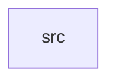

_Generated by CodeAtlas._

## Details

Owns 0 symbols across 1 file(s).

### src

Owns 23 symbols across 4 file(s).

**Related Classes/Methods:** _None_

**Source Files:**

- `crates/drivers/src/discovery.rs`
  - `crates.drivers.src.discovery.DiscoveredDevice`
  - `crates.drivers.src.discovery.DiscoveredDevice.new`
  - `crates.drivers.src.discovery.HardwareDiscovery`
  - `crates.drivers.src.discovery.HardwareDiscovery.add_device`
  - `crates.drivers.src.discovery.HardwareDiscovery.new`
  - `crates.drivers.src.discovery.HardwareDiscovery.scan`
  - `crates.drivers.src.discovery.HardwareDiscovery.scan_by_class`
  - `crates.drivers.src.discovery.tests.empty_bus_scans_to_empty`
  - `crates.drivers.src.discovery.tests.scan_by_class_filters`
  - `crates.drivers.src.discovery.tests.scan_returns_all_added_devices`
- `crates/drivers/src/registry.rs`
  - `crates.drivers.src.registry.DriverRegistry`
  - `crates.drivers.src.registry.DriverRegistry.match_driver`
  - `crates.drivers.src.registry.DriverRegistry.new`
  - `crates.drivers.src.registry.DriverRegistry.register`
  - `crates.drivers.src.registry.DriverRegistry.registered_classes`
  - `crates.drivers.src.registry.DriverRegistry.unregister`
  - `crates.drivers.src.registry.tests.re_registering_replaces_driver`
  - `crates.drivers.src.registry.tests.register_and_match`
  - `crates.drivers.src.registry.tests.unmatched_class_returns_none`
  - `crates.drivers.src.registry.tests.unregister_removes_mapping`
- `crates/drivers/src/sandbox.rs`
  - `crates.drivers.src.sandbox.init`
  - `crates.drivers.src.sandbox.tests.each_init_call_creates_a_distinct_sandbox`
  - `crates.drivers.src.sandbox.tests.init_creates_locked_down_sandbox`
