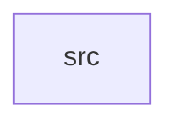

_Generated by CodeAtlas._

## Details

Owns 0 symbols across 1 file(s).

### src

Owns 38 symbols across 1 file(s).

**Related Classes/Methods:** _None_

**Source Files:**

- `crates/gpu_driver/src/lib.rs`
  - `crates.gpu_driver.src.lib.Connector`
  - `crates.gpu_driver.src.lib.ConnectorStatus`
  - `crates.gpu_driver.src.lib.ConnectorType`
  - `crates.gpu_driver.src.lib.DisplayMode`
  - `crates.gpu_driver.src.lib.Framebuffer`
  - `crates.gpu_driver.src.lib.GPUDriver`
  - `crates.gpu_driver.src.lib.GPUDriver.allocate_framebuffer`
  - `crates.gpu_driver.src.lib.GPUDriver.connector_count`
  - `crates.gpu_driver.src.lib.GPUDriver.detect_hotplug`
  - `crates.gpu_driver.src.lib.GPUDriver.framebuffer_count`
  - `crates.gpu_driver.src.lib.GPUDriver.free_framebuffer`
  - `crates.gpu_driver.src.lib.GPUDriver.get_connector`
  - `crates.gpu_driver.src.lib.GPUDriver.get_connectors`
  - `crates.gpu_driver.src.lib.GPUDriver.get_framebuffer`
  - `crates.gpu_driver.src.lib.GPUDriver.get_memory_info`
  - `crates.gpu_driver.src.lib.GPUDriver.get_primary_display`
  - `crates.gpu_driver.src.lib.GPUDriver.initialize`
  - `crates.gpu_driver.src.lib.GPUDriver.is_initialized`
  - `crates.gpu_driver.src.lib.GPUDriver.new`
  - `crates.gpu_driver.src.lib.GPUDriver.page_flip`
  - `crates.gpu_driver.src.lib.GPUDriver.register_connector`
  - `crates.gpu_driver.src.lib.GPUDriver.set_mode`
  - `crates.gpu_driver.src.lib.GPUMemory`
  - `crates.gpu_driver.src.lib.tests.test_allocate_framebuffer`
  - `crates.gpu_driver.src.lib.tests.test_allocate_multiple_framebuffers`
  - `crates.gpu_driver.src.lib.tests.test_framebuffer_vram_cleanup`
  - `crates.gpu_driver.src.lib.tests.test_free_framebuffer`
  - `crates.gpu_driver.src.lib.tests.test_get_connectors`
  - `crates.gpu_driver.src.lib.tests.test_gpu_driver_creation`
  - `crates.gpu_driver.src.lib.tests.test_gpu_driver_initialization`
  - `crates.gpu_driver.src.lib.tests.test_hotplug_detection`
  - `crates.gpu_driver.src.lib.tests.test_out_of_vram`
  - `crates.gpu_driver.src.lib.tests.test_page_flip`
  - `crates.gpu_driver.src.lib.tests.test_primary_display_selection`
  - `crates.gpu_driver.src.lib.tests.test_register_connector`
  - `crates.gpu_driver.src.lib.tests.test_set_mode`
  - `crates.gpu_driver.src.lib.tests.test_unsupported_mode`
  - `crates.gpu_driver.src.lib.tests.test_vram_tracking`
