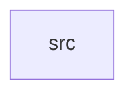

_Generated by CodeAtlas._

## Details

Owns 0 symbols across 1 file(s).

### src

Owns 30 symbols across 1 file(s).

**Related Classes/Methods:** _None_

**Source Files:**

- `crates/hal/src/lib.rs`
  - `crates.hal.src.lib.DeviceInfo`
  - `crates.hal.src.lib.DeviceType`
  - `crates.hal.src.lib.HardwareAbstractionLayer`
  - `crates.hal.src.lib.HardwareAbstractionLayer.default`
  - `crates.hal.src.lib.HardwareAbstractionLayer.device_count`
  - `crates.hal.src.lib.HardwareAbstractionLayer.get_device`
  - `crates.hal.src.lib.HardwareAbstractionLayer.get_devices_by_type`
  - `crates.hal.src.lib.HardwareAbstractionLayer.get_mapping`
  - `crates.hal.src.lib.HardwareAbstractionLayer.map_memory`
  - `crates.hal.src.lib.HardwareAbstractionLayer.new`
  - `crates.hal.src.lib.HardwareAbstractionLayer.probe_devices`
  - `crates.hal.src.lib.HardwareAbstractionLayer.read_register`
  - `crates.hal.src.lib.HardwareAbstractionLayer.register_driver`
  - `crates.hal.src.lib.HardwareAbstractionLayer.write_register`
  - `crates.hal.src.lib.HardwareDriver`
  - `crates.hal.src.lib.MemoryMapping`
  - `crates.hal.src.lib.tests.MockDriver`
  - `crates.hal.src.lib.tests.MockDriver.get_capabilities`
  - `crates.hal.src.lib.tests.MockDriver.initialize`
  - `crates.hal.src.lib.tests.MockDriver.probe`
  - `crates.hal.src.lib.tests.MockDriver.read_register`
  - `crates.hal.src.lib.tests.MockDriver.shutdown`
  - `crates.hal.src.lib.tests.MockDriver.write_register`
  - `crates.hal.src.lib.tests.test_device_probing`
  - `crates.hal.src.lib.tests.test_device_retrieval`
  - `crates.hal.src.lib.tests.test_driver_registration`
  - `crates.hal.src.lib.tests.test_get_devices_by_type`
  - `crates.hal.src.lib.tests.test_hal_creation`
  - `crates.hal.src.lib.tests.test_memory_mapping`
  - `crates.hal.src.lib.tests.test_register_operations`
