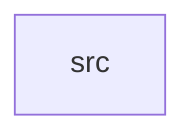

_Generated by CodeAtlas._

## Details

Owns 0 symbols across 1 file(s).

### src

Owns 49 symbols across 3 file(s).

**Related Classes/Methods:** _None_

**Source Files:**

- `crates/hardening/src/memory_safety.rs`
  - `crates.hardening.src.memory_safety.AuditResult`
  - `crates.hardening.src.memory_safety.MemorySafetyAudit`
  - `crates.hardening.src.memory_safety.MemorySafetyValidator`
  - `crates.hardening.src.memory_safety.MemorySafetyValidator.audit`
  - `crates.hardening.src.memory_safety.MemorySafetyValidator.check_bounds`
  - `crates.hardening.src.memory_safety.MemorySafetyValidator.default`
  - `crates.hardening.src.memory_safety.MemorySafetyValidator.get_double_free_count`
  - `crates.hardening.src.memory_safety.MemorySafetyValidator.get_leaked_allocations`
  - `crates.hardening.src.memory_safety.MemorySafetyValidator.get_use_after_free_count`
  - `crates.hardening.src.memory_safety.MemorySafetyValidator.is_valid_alignment`
  - `crates.hardening.src.memory_safety.MemorySafetyValidator.new`
  - `crates.hardening.src.memory_safety.MemorySafetyValidator.record_free`
  - `crates.hardening.src.memory_safety.MemorySafetyValidator.record_use`
  - `crates.hardening.src.memory_safety.MemorySafetyValidator.register_allocation`
  - `crates.hardening.src.memory_safety.MemorySafetyValidator.reset`
  - `crates.hardening.src.memory_safety.tests.test_allocation_registration`
  - `crates.hardening.src.memory_safety.tests.test_audit`
  - `crates.hardening.src.memory_safety.tests.test_bounds_checking`
  - `crates.hardening.src.memory_safety.tests.test_double_free_detection`
  - `crates.hardening.src.memory_safety.tests.test_invalid_alignment`
  - `crates.hardening.src.memory_safety.tests.test_leaked_allocations`
  - `crates.hardening.src.memory_safety.tests.test_use_after_free_detection`
  - `crates.hardening.src.memory_safety.tests.test_zero_size_allocation`
- `crates/hardening/src/syscall_hardening.rs`
  - `crates.hardening.src.syscall_hardening.SyscallAudit`
  - `crates.hardening.src.syscall_hardening.SyscallHardener`
  - `crates.hardening.src.syscall_hardening.SyscallHardener.add_allowed_syscall`
  - `crates.hardening.src.syscall_hardening.SyscallHardener.check_rate_limit`
  - `crates.hardening.src.syscall_hardening.SyscallHardener.get_audit`
  - `crates.hardening.src.syscall_hardening.SyscallHardener.get_driver_audit`
  - `crates.hardening.src.syscall_hardening.SyscallHardener.new`
  - `crates.hardening.src.syscall_hardening.SyscallHardener.record_blocked`
  - `crates.hardening.src.syscall_hardening.SyscallHardener.record_call`
  - `crates.hardening.src.syscall_hardening.SyscallHardener.remove_allowed_syscall`
  - `crates.hardening.src.syscall_hardening.SyscallHardener.reset`
  - `crates.hardening.src.syscall_hardening.SyscallHardener.validate_parameters`
  - `crates.hardening.src.syscall_hardening.SyscallHardener.validate_return_value`
  - `crates.hardening.src.syscall_hardening.SyscallHardener.validate_syscall`
  - `crates.hardening.src.syscall_hardening.SyscallPolicy`
  - `crates.hardening.src.syscall_hardening.SyscallPolicy.default`
  - `crates.hardening.src.syscall_hardening.SyscallType`
  - `crates.hardening.src.syscall_hardening.tests.test_add_syscall`
  - `crates.hardening.src.syscall_hardening.tests.test_allowed_syscall`
  - `crates.hardening.src.syscall_hardening.tests.test_audit_tracking`
  - `crates.hardening.src.syscall_hardening.tests.test_blocked_syscall`
  - `crates.hardening.src.syscall_hardening.tests.test_parameter_validation`
  - `crates.hardening.src.syscall_hardening.tests.test_remove_syscall`
  - `crates.hardening.src.syscall_hardening.tests.test_reset`
  - `crates.hardening.src.syscall_hardening.tests.test_return_value_validation`
  - `crates.hardening.src.syscall_hardening.tests.test_syscall_policy_default`
