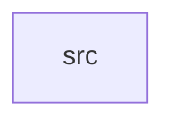

_Generated by CodeAtlas._

## Details

Owns 0 symbols across 1 file(s).

### src

Owns 48 symbols across 1 file(s).

**Related Classes/Methods:** _None_

**Source Files:**

- `crates/input_driver/src/lib.rs`
  - `crates.input_driver.src.lib.InputDevice`
  - `crates.input_driver.src.lib.InputDeviceType`
  - `crates.input_driver.src.lib.InputDriver`
  - `crates.input_driver.src.lib.InputDriver.activate_device`
  - `crates.input_driver.src.lib.InputDriver.deactivate_device`
  - `crates.input_driver.src.lib.InputDriver.default`
  - `crates.input_driver.src.lib.InputDriver.device_count`
  - `crates.input_driver.src.lib.InputDriver.end_touch`
  - `crates.input_driver.src.lib.InputDriver.get_active_touches`
  - `crates.input_driver.src.lib.InputDriver.get_device`
  - `crates.input_driver.src.lib.InputDriver.get_devices_by_type`
  - `crates.input_driver.src.lib.InputDriver.get_key_event`
  - `crates.input_driver.src.lib.InputDriver.get_keyboards`
  - `crates.input_driver.src.lib.InputDriver.get_motion_event`
  - `crates.input_driver.src.lib.InputDriver.get_multitouch_event`
  - `crates.input_driver.src.lib.InputDriver.get_pointing_devices`
  - `crates.input_driver.src.lib.InputDriver.get_repeat_rate`
  - `crates.input_driver.src.lib.InputDriver.key_queue_len`
  - `crates.input_driver.src.lib.InputDriver.motion_queue_len`
  - `crates.input_driver.src.lib.InputDriver.new`
  - `crates.input_driver.src.lib.InputDriver.queue_key_event`
  - `crates.input_driver.src.lib.InputDriver.queue_motion_event`
  - `crates.input_driver.src.lib.InputDriver.queue_multitouch`
  - `crates.input_driver.src.lib.InputDriver.register_device`
  - `crates.input_driver.src.lib.InputDriver.set_repeat_rate`
  - `crates.input_driver.src.lib.InputDriver.start_touch`
  - `crates.input_driver.src.lib.InputDriver.touch_queue_len`
  - `crates.input_driver.src.lib.InputDriver.update_touch`
  - `crates.input_driver.src.lib.KeyEvent`
  - `crates.input_driver.src.lib.KeyEventType`
  - `crates.input_driver.src.lib.MotionEvent`
  - `crates.input_driver.src.lib.MultiTouchEvent`
  - `crates.input_driver.src.lib.Touch`
  - `crates.input_driver.src.lib.tests.test_activate_device`
  - `crates.input_driver.src.lib.tests.test_end_touch`
  - `crates.input_driver.src.lib.tests.test_event_ordering`
  - `crates.input_driver.src.lib.tests.test_get_keyboards`
  - `crates.input_driver.src.lib.tests.test_get_pointing_devices`
  - `crates.input_driver.src.lib.tests.test_input_driver_creation`
  - `crates.input_driver.src.lib.tests.test_key_event_queue`
  - `crates.input_driver.src.lib.tests.test_mixed_device_types`
  - `crates.input_driver.src.lib.tests.test_motion_event_queue`
  - `crates.input_driver.src.lib.tests.test_multitouch_basic`
  - `crates.input_driver.src.lib.tests.test_multitouch_event_queue`
  - `crates.input_driver.src.lib.tests.test_register_keyboard`
  - `crates.input_driver.src.lib.tests.test_register_mouse`
  - `crates.input_driver.src.lib.tests.test_repeat_rate_setting`
  - `crates.input_driver.src.lib.tests.test_update_touch`
