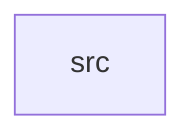

_Generated by CodeAtlas._

## Details

Owns 0 symbols across 1 file(s).

### src

Owns 23 symbols across 3 file(s).

**Related Classes/Methods:** _None_

**Source Files:**

- `crates/interrupt/src/controller.rs`
  - `crates.interrupt.src.controller.InterruptController`
  - `crates.interrupt.src.controller.InterruptController.disable_irq`
  - `crates.interrupt.src.controller.InterruptController.dispatch`
  - `crates.interrupt.src.controller.InterruptController.enable_irq`
  - `crates.interrupt.src.controller.InterruptController.get_handler`
  - `crates.interrupt.src.controller.InterruptController.get_handlers`
  - `crates.interrupt.src.controller.InterruptController.new`
  - `crates.interrupt.src.controller.InterruptController.register_handler`
  - `crates.interrupt.src.controller.InterruptController.unregister_by_id`
  - `crates.interrupt.src.controller.InterruptController.unregister_handler`
  - `crates.interrupt.src.controller.tests.disabled_irq_dispatches_nothing_but_does_not_error`
  - `crates.interrupt.src.controller.tests.dispatch_on_unregistered_irq_errors`
  - `crates.interrupt.src.controller.tests.invocation_count_increments_per_dispatch`
  - `crates.interrupt.src.controller.tests.register_and_get_handler`
  - `crates.interrupt.src.controller.tests.shared_irq_dispatches_in_priority_order`
  - `crates.interrupt.src.controller.tests.unregister_by_id_only_removes_that_handler`
  - `crates.interrupt.src.controller.tests.unregister_handler_clears_whole_line`
- `crates/interrupt/src/handler.rs`
  - `crates.interrupt.src.handler.InterruptHandler`
  - `crates.interrupt.src.handler.InterruptHandler.new`
  - `crates.interrupt.src.handler.InterruptHandler.with_affinity`
  - `crates.interrupt.src.handler.InterruptHandler.with_priority`
  - `crates.interrupt.src.handler.tests.builder_methods_set_fields`
  - `crates.interrupt.src.handler.tests.new_handler_starts_enabled_with_default_priority`
