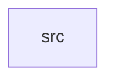

_Generated by CodeAtlas._

## Details

Owns 0 symbols across 1 file(s).

### src

Owns 18 symbols across 4 file(s).

**Related Classes/Methods:** _None_

**Source Files:**

- `crates/kernel/src/config.rs`
  - `crates.kernel.src.config.KernelConfig`
  - `crates.kernel.src.config.KernelConfig.default`
  - `crates.kernel.src.config.SecurityLevel`
- `crates/kernel/src/kernel.rs`
  - `crates.kernel.src.kernel.KernelStatus`
  - `crates.kernel.src.kernel.SherKernel`
  - `crates.kernel.src.kernel.SherKernel.check_anomaly`
  - `crates.kernel.src.kernel.SherKernel.initialize`
  - `crates.kernel.src.kernel.SherKernel.new`
  - `crates.kernel.src.kernel.SherKernel.register_device`
  - `crates.kernel.src.kernel.SherKernel.shutdown`
  - `crates.kernel.src.kernel.SherKernel.status`
  - `crates.kernel.src.kernel.SherKernel.uptime`
  - `crates.kernel.src.kernel.tests.initialize_activates_ai_services_when_enabled`
  - `crates.kernel.src.kernel.tests.initialize_skips_ai_services_when_disabled`
  - `crates.kernel.src.kernel.tests.shutdown_clears_active_drivers_and_audits`
  - `crates.kernel.src.kernel.tests.status_reflects_memory_usage`
  - `crates.kernel.src.kernel.tests.uptime_does_not_panic_when_boot_time_is_in_the_future`
- `crates/kernel/src/main.rs`
  - `crates.kernel.src.main.main`
