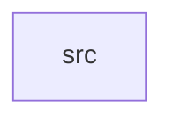

_Generated by CodeAtlas._

## Details

Owns 0 symbols across 1 file(s).

### src

Owns 320 symbols across 12 file(s).

**Related Classes/Methods:** _None_

**Source Files:**

- `crates/lki/src/audit.rs`
  - `crates.lki.src.audit.AuditEntry`
  - `crates.lki.src.audit.AuditEntry.new`
  - `crates.lki.src.audit.AuditEntry.with_duration`
  - `crates.lki.src.audit.AuditEntry.with_level`
  - `crates.lki.src.audit.AuditEntry.with_result`
  - `crates.lki.src.audit.AuditFilter`
  - `crates.lki.src.audit.AuditFilter.matches`
  - `crates.lki.src.audit.AuditFilter.new`
  - `crates.lki.src.audit.AuditFilter.with_api`
  - `crates.lki.src.audit.AuditFilter.with_driver`
  - `crates.lki.src.audit.AuditFilter.with_level`
  - `crates.lki.src.audit.AuditFilter.with_min_latency`
  - `crates.lki.src.audit.AuditLevel`
  - `crates.lki.src.audit.AuditLog`
  - `crates.lki.src.audit.AuditLog.avg_latency_for_api`
  - `crates.lki.src.audit.AuditLog.clear`
  - `crates.lki.src.audit.AuditLog.critical_count`
  - `crates.lki.src.audit.AuditLog.entries`
  - `crates.lki.src.audit.AuditLog.entries_by_api`
  - `crates.lki.src.audit.AuditLog.entries_by_driver`
  - `crates.lki.src.audit.AuditLog.entries_by_level`
  - `crates.lki.src.audit.AuditLog.error_count`
  - `crates.lki.src.audit.AuditLog.info_count`
  - `crates.lki.src.audit.AuditLog.log`
  - `crates.lki.src.audit.AuditLog.new`
  - `crates.lki.src.audit.AuditLog.peak_latency_for_api`
  - `crates.lki.src.audit.AuditLog.recent_entries`
  - `crates.lki.src.audit.AuditLog.stats`
  - `crates.lki.src.audit.AuditLog.total_entries`
  - `crates.lki.src.audit.AuditLog.warning_count`
  - `crates.lki.src.audit.AuditStats`
- `crates/lki/src/device_compat.rs`
  - `crates.lki.src.device_compat.LinuxDeviceApi`
  - `crates.lki.src.device_compat.LinuxDeviceApi.get_registered_drivers`
  - `crates.lki.src.device_compat.LinuxDeviceApi.pci_driver_register`
  - `crates.lki.src.device_compat.LinuxDeviceApi.pci_driver_unregister`
- `crates/lki/src/device_translation.rs`
  - `crates.lki.src.device_translation.BlockDevice`
  - `crates.lki.src.device_translation.BlockDevice.new`
  - `crates.lki.src.device_translation.BlockDevice.register`
  - `crates.lki.src.device_translation.BlockDevice.set_read_only`
  - `crates.lki.src.device_translation.BlockDevice.unregister`
  - `crates.lki.src.device_translation.BlockDeviceManager`
  - `crates.lki.src.device_translation.BlockDeviceManager.get_device`
  - `crates.lki.src.device_translation.BlockDeviceManager.new`
  - `crates.lki.src.device_translation.BlockDeviceManager.register_block_device`
  - `crates.lki.src.device_translation.BlockDeviceManager.unregister_block_device`
  - `crates.lki.src.device_translation.BlockDeviceType`
  - `crates.lki.src.device_translation.BusType`
  - `crates.lki.src.device_translation.DeviceBus`
  - `crates.lki.src.device_translation.DeviceBus.add_device`
  - `crates.lki.src.device_translation.DeviceBus.add_driver`
  - `crates.lki.src.device_translation.DeviceBus.device_count`
  - `crates.lki.src.device_translation.DeviceBus.driver_count`
  - `crates.lki.src.device_translation.DeviceBus.new`
  - `crates.lki.src.device_translation.DeviceBus.remove_device`
  - `crates.lki.src.device_translation.DeviceManager`
  - `crates.lki.src.device_translation.DeviceManager.bus_add_device`
  - `crates.lki.src.device_translation.DeviceManager.bus_add_driver`
  - `crates.lki.src.device_translation.DeviceManager.disable_device`
  - `crates.lki.src.device_translation.DeviceManager.enable_device`
  - `crates.lki.src.device_translation.DeviceManager.find_devices_by_class`
  - `crates.lki.src.device_translation.DeviceManager.find_devices_by_vendor`
  - `crates.lki.src.device_translation.DeviceManager.get_device_by_bdf`
  - `crates.lki.src.device_translation.DeviceManager.get_driver_for_device`
  - `crates.lki.src.device_translation.DeviceManager.get_stats`
  - `crates.lki.src.device_translation.DeviceManager.new`
  - `crates.lki.src.device_translation.DeviceManager.probe_device_drivers`
  - `crates.lki.src.device_translation.DeviceManager.register_bus`
  - `crates.lki.src.device_translation.DeviceManager.register_pci_device`
  - `crates.lki.src.device_translation.DeviceManager.register_pci_driver`
  - `crates.lki.src.device_translation.DeviceManager.unregister_pci_driver`
  - `crates.lki.src.device_translation.DeviceStats`
  - `crates.lki.src.device_translation.NetDeviceType`
  - `crates.lki.src.device_translation.NetworkDevice`
  - `crates.lki.src.device_translation.NetworkDevice.new`
  - `crates.lki.src.device_translation.NetworkDevice.register`
  - `crates.lki.src.device_translation.NetworkDevice.set_mac`
  - `crates.lki.src.device_translation.NetworkDevice.unregister`
  - `crates.lki.src.device_translation.NetworkDeviceManager`
  - `crates.lki.src.device_translation.NetworkDeviceManager.get_device`
  - `crates.lki.src.device_translation.NetworkDeviceManager.list_devices`
  - `crates.lki.src.device_translation.NetworkDeviceManager.new`
  - `crates.lki.src.device_translation.NetworkDeviceManager.register_net_device`
  - `crates.lki.src.device_translation.NetworkDeviceManager.unregister_net_device`
  - `crates.lki.src.device_translation.PciDevice`
  - `crates.lki.src.device_translation.PciDevice.add_bar`
  - `crates.lki.src.device_translation.PciDevice.bdf`
  - `crates.lki.src.device_translation.PciDevice.disable`
  - `crates.lki.src.device_translation.PciDevice.enable`
  - `crates.lki.src.device_translation.PciDevice.new`
  - `crates.lki.src.device_translation.PciDeviceId`
  - `crates.lki.src.device_translation.PciDeviceId.matches`
  - `crates.lki.src.device_translation.PciDeviceId.new`
  - `crates.lki.src.device_translation.PciDriver`
  - `crates.lki.src.device_translation.PciDriver.add_device`
  - `crates.lki.src.device_translation.PciDriver.new`
  - `crates.lki.src.device_translation.PciDriver.probe_success_rate`
  - `crates.lki.src.device_translation.PciDriver.record_probe`
  - `crates.lki.src.device_translation.PciDriver.supports_device`
- `crates/lki/src/enforcement.rs`
  - `crates.lki.src.enforcement.EnforcementStats`
  - `crates.lki.src.enforcement.PermissionChecker`
  - `crates.lki.src.enforcement.PermissionChecker.check`
  - `crates.lki.src.enforcement.PermissionChecker.clear_all`
  - `crates.lki.src.enforcement.PermissionChecker.clear_cache`
  - `crates.lki.src.enforcement.PermissionChecker.get_stats`
  - `crates.lki.src.enforcement.PermissionChecker.new`
  - `crates.lki.src.enforcement.PermissionStats`
  - `crates.lki.src.enforcement.SecurityContext`
  - `crates.lki.src.enforcement.SecurityContext.check_operation`
  - `crates.lki.src.enforcement.SecurityContext.check_with_reauthentication`
  - `crates.lki.src.enforcement.SecurityContext.denial_rate`
  - `crates.lki.src.enforcement.SecurityContext.new`
  - `crates.lki.src.enforcement.SecurityEnforcer`
  - `crates.lki.src.enforcement.SecurityEnforcer.enforce`
  - `crates.lki.src.enforcement.SecurityEnforcer.enforce_with_reauth`
  - `crates.lki.src.enforcement.SecurityEnforcer.find_suspicious_contexts`
  - `crates.lki.src.enforcement.SecurityEnforcer.get_context`
  - `crates.lki.src.enforcement.SecurityEnforcer.get_context_mut`
  - `crates.lki.src.enforcement.SecurityEnforcer.get_stats`
  - `crates.lki.src.enforcement.SecurityEnforcer.new`
  - `crates.lki.src.enforcement.SecurityEnforcer.register_driver`
  - `crates.lki.src.enforcement.SecurityEnforcer.unregister_driver`
- `crates/lki/src/interrupt_translation.rs`
  - `crates.lki.src.interrupt_translation.InterruptHandler`
  - `crates.lki.src.interrupt_translation.InterruptHandler.disable`
  - `crates.lki.src.interrupt_translation.InterruptHandler.enable`
  - `crates.lki.src.interrupt_translation.InterruptHandler.new`
  - `crates.lki.src.interrupt_translation.InterruptHandler.record_call`
  - `crates.lki.src.interrupt_translation.InterruptHandler.record_error`
  - `crates.lki.src.interrupt_translation.InterruptHandler.with_priority`
  - `crates.lki.src.interrupt_translation.InterruptManager`
  - `crates.lki.src.interrupt_translation.InterruptManager.active_interrupts`
  - `crates.lki.src.interrupt_translation.InterruptManager.disable_irq`
  - `crates.lki.src.interrupt_translation.InterruptManager.enable_irq`
  - `crates.lki.src.interrupt_translation.InterruptManager.find_high_latency_irqs`
  - `crates.lki.src.interrupt_translation.InterruptManager.free_irq`
  - `crates.lki.src.interrupt_translation.InterruptManager.get_handler`
  - `crates.lki.src.interrupt_translation.InterruptManager.get_stats`
  - `crates.lki.src.interrupt_translation.InterruptManager.is_shared_irq`
  - `crates.lki.src.interrupt_translation.InterruptManager.new`
  - `crates.lki.src.interrupt_translation.InterruptManager.registered_interrupts`
  - `crates.lki.src.interrupt_translation.InterruptManager.request_irq`
  - `crates.lki.src.interrupt_translation.InterruptStats`
  - `crates.lki.src.interrupt_translation.IrqPriority`
  - `crates.lki.src.interrupt_translation.IrqReturnValue`
  - `crates.lki.src.interrupt_translation.IrqTrigger`
- `crates/lki/src/linux_api.rs`
  - `crates.lki.src.linux_api.LinuxKernelInterface`
  - `crates.lki.src.linux_api.LinuxKernelInterface.call_api`
  - `crates.lki.src.linux_api.LinuxKernelInterface.new`
  - `crates.lki.src.linux_api.LinuxKernelInterface.supports_api`
- `crates/lki/src/memory_compat.rs`
  - `crates.lki.src.memory_compat.LinuxMemoryApi`
  - `crates.lki.src.memory_compat.LinuxMemoryApi.kfree`
  - `crates.lki.src.memory_compat.LinuxMemoryApi.kmalloc`
- `crates/lki/src/memory_translation.rs`
  - `crates.lki.src.memory_translation.AllocationMode`
  - `crates.lki.src.memory_translation.GfpFlag`
  - `crates.lki.src.memory_translation.LinuxMemoryAllocator`
  - `crates.lki.src.memory_translation.LinuxMemoryAllocator.active_allocations`
  - `crates.lki.src.memory_translation.LinuxMemoryAllocator.current_usage`
  - `crates.lki.src.memory_translation.LinuxMemoryAllocator.dma_alloc`
  - `crates.lki.src.memory_translation.LinuxMemoryAllocator.find_leaks`
  - `crates.lki.src.memory_translation.LinuxMemoryAllocator.get_allocation`
  - `crates.lki.src.memory_translation.LinuxMemoryAllocator.get_stats`
  - `crates.lki.src.memory_translation.LinuxMemoryAllocator.kfree`
  - `crates.lki.src.memory_translation.LinuxMemoryAllocator.kmalloc`
  - `crates.lki.src.memory_translation.LinuxMemoryAllocator.kzalloc`
  - `crates.lki.src.memory_translation.LinuxMemoryAllocator.new`
  - `crates.lki.src.memory_translation.LinuxMemoryAllocator.peak_usage`
  - `crates.lki.src.memory_translation.LinuxMemoryAllocator.vmalloc`
  - `crates.lki.src.memory_translation.MemoryAllocation`
  - `crates.lki.src.memory_translation.MemoryAllocation.lifetime_ms`
  - `crates.lki.src.memory_translation.MemoryAllocation.new`
  - `crates.lki.src.memory_translation.MemoryAllocation.with_alignment`
  - `crates.lki.src.memory_translation.MemoryAllocation.with_flags`
  - `crates.lki.src.memory_translation.MemoryAllocation.with_zeroed`
  - `crates.lki.src.memory_translation.MemoryStats`
- `crates/lki/src/security.rs`
  - `crates.lki.src.security.Capability`
  - `crates.lki.src.security.CapabilityGrant`
  - `crates.lki.src.security.CapabilityGrant.is_expired`
  - `crates.lki.src.security.CapabilityGrant.is_valid`
  - `crates.lki.src.security.CapabilityGrant.lifetime_ms`
  - `crates.lki.src.security.CapabilityGrant.new`
  - `crates.lki.src.security.CapabilityGrant.time_remaining_ms`
  - `crates.lki.src.security.CapabilityGrant.with_duration`
  - `crates.lki.src.security.CapabilityGrant.with_reason`
  - `crates.lki.src.security.CapabilityGrant.with_reauth`
  - `crates.lki.src.security.CapabilityManager`
  - `crates.lki.src.security.CapabilityManager.check_with_reauth`
  - `crates.lki.src.security.CapabilityManager.cleanup_expired`
  - `crates.lki.src.security.CapabilityManager.get_active_grants`
  - `crates.lki.src.security.CapabilityManager.get_expiring_grants`
  - `crates.lki.src.security.CapabilityManager.get_grant`
  - `crates.lki.src.security.CapabilityManager.get_stats`
  - `crates.lki.src.security.CapabilityManager.grant`
  - `crates.lki.src.security.CapabilityManager.has_capability`
  - `crates.lki.src.security.CapabilityManager.new`
  - `crates.lki.src.security.CapabilityManager.revoke`
  - `crates.lki.src.security.PermissionTier`
  - `crates.lki.src.security.PermissionTier.max_duration_ms`
  - `crates.lki.src.security.PermissionTier.recommended_duration_ms`
  - `crates.lki.src.security.ReauthMethod`
  - `crates.lki.src.security.SecurityLevel`
  - `crates.lki.src.security.SecurityPolicy`
  - `crates.lki.src.security.SecurityPolicy.allows_tier`
  - `crates.lki.src.security.SecurityPolicy.new`
  - `crates.lki.src.security.SecurityStats`
- `crates/lki/src/tests.rs`
  - `crates.lki.src.tests.tests.test_audit_entries_by_driver`
  - `crates.lki.src.tests.tests.test_audit_entries_by_level`
  - `crates.lki.src.tests.tests.test_audit_error_rate`
  - `crates.lki.src.tests.tests.test_audit_filter`
  - `crates.lki.src.tests.tests.test_audit_log_entry`
  - `crates.lki.src.tests.tests.test_audit_log_levels`
  - `crates.lki.src.tests.tests.test_audit_log_max_entries`
  - `crates.lki.src.tests.tests.test_audit_log_new`
  - `crates.lki.src.tests.tests.test_block_device_manager_duplicate`
  - `crates.lki.src.tests.tests.test_block_device_manager_register`
  - `crates.lki.src.tests.tests.test_block_device_new`
  - `crates.lki.src.tests.tests.test_block_device_register`
  - `crates.lki.src.tests.tests.test_capability_grant_duration_limit`
  - `crates.lki.src.tests.tests.test_capability_grant_new`
  - `crates.lki.src.tests.tests.test_capability_grant_time_remaining`
  - `crates.lki.src.tests.tests.test_capability_grant_validity`
  - `crates.lki.src.tests.tests.test_capability_grant_with_duration`
  - `crates.lki.src.tests.tests.test_capability_manager_cleanup_expired`
  - `crates.lki.src.tests.tests.test_capability_manager_grant`
  - `crates.lki.src.tests.tests.test_capability_manager_has_capability`
  - `crates.lki.src.tests.tests.test_capability_manager_revoke`
  - `crates.lki.src.tests.tests.test_device_bus_add_device`
  - `crates.lki.src.tests.tests.test_device_bus_new`
  - `crates.lki.src.tests.tests.test_device_bus_remove_device`
  - `crates.lki.src.tests.tests.test_device_manager_bus_add_device`
  - `crates.lki.src.tests.tests.test_device_manager_driver_device_matching`
  - `crates.lki.src.tests.tests.test_device_manager_enable_disable`
  - `crates.lki.src.tests.tests.test_device_manager_find_by_vendor`
  - `crates.lki.src.tests.tests.test_device_manager_new`
  - `crates.lki.src.tests.tests.test_device_manager_register_bus`
  - `crates.lki.src.tests.tests.test_device_manager_register_pci_device`
  - `crates.lki.src.tests.tests.test_device_manager_register_pci_driver`
  - `crates.lki.src.tests.tests.test_device_manager_stats`
  - `crates.lki.src.tests.tests.test_dma_alloc`
  - `crates.lki.src.tests.tests.test_enable_disable_irq`
  - `crates.lki.src.tests.tests.test_enforcer_stats`
  - `crates.lki.src.tests.tests.test_find_memory_leaks`
  - `crates.lki.src.tests.tests.test_free_irq`
  - `crates.lki.src.tests.tests.test_free_irq_wrong_driver`
  - `crates.lki.src.tests.tests.test_interrupt_handler_latency`
  - `crates.lki.src.tests.tests.test_interrupt_manager_new`
  - `crates.lki.src.tests.tests.test_interrupt_stats`
  - `crates.lki.src.tests.tests.test_kfree_double_free`
  - `crates.lki.src.tests.tests.test_kfree_invalid_pointer`
  - `crates.lki.src.tests.tests.test_kfree_valid`
  - `crates.lki.src.tests.tests.test_kmalloc_basic`
  - `crates.lki.src.tests.tests.test_kmalloc_multiple`
  - `crates.lki.src.tests.tests.test_kmalloc_too_large`
  - `crates.lki.src.tests.tests.test_kzalloc`
  - `crates.lki.src.tests.tests.test_memory_allocator_new`
  - `crates.lki.src.tests.tests.test_memory_peak_tracking`
  - `crates.lki.src.tests.tests.test_memory_stats`
  - `crates.lki.src.tests.tests.test_network_device_manager_duplicate`
  - `crates.lki.src.tests.tests.test_network_device_manager_list`
  - `crates.lki.src.tests.tests.test_network_device_manager_register`
  - `crates.lki.src.tests.tests.test_network_device_new`
  - `crates.lki.src.tests.tests.test_network_device_set_mac`
  - `crates.lki.src.tests.tests.test_pci_device_add_bar`
  - `crates.lki.src.tests.tests.test_pci_device_bdf`
  - `crates.lki.src.tests.tests.test_pci_device_enable_disable`
  - `crates.lki.src.tests.tests.test_pci_device_id_matches_exact`
  - `crates.lki.src.tests.tests.test_pci_device_id_matches_wildcard`
  - `crates.lki.src.tests.tests.test_pci_device_id_new`
  - `crates.lki.src.tests.tests.test_pci_driver_add_device`
  - `crates.lki.src.tests.tests.test_pci_driver_new`
  - `crates.lki.src.tests.tests.test_pci_driver_probe_tracking`
  - `crates.lki.src.tests.tests.test_pci_driver_supports_device`
  - `crates.lki.src.tests.tests.test_permission_checker_cache_clear`
  - `crates.lki.src.tests.tests.test_permission_checker_caching`
  - `crates.lki.src.tests.tests.test_permission_checker_does_not_cache_granted_result`
  - `crates.lki.src.tests.tests.test_permission_checker_stats`
  - `crates.lki.src.tests.tests.test_permission_tier_durations`
  - `crates.lki.src.tests.tests.test_reauth_requirement`
  - `crates.lki.src.tests.tests.test_request_irq_basic`
  - `crates.lki.src.tests.tests.test_request_irq_duplicate_non_shared`
  - `crates.lki.src.tests.tests.test_request_irq_shared`
  - `crates.lki.src.tests.tests.test_security_context_check_unrestricted`
  - `crates.lki.src.tests.tests.test_security_context_check_with_grant`
  - `crates.lki.src.tests.tests.test_security_context_denial_rate`
  - `crates.lki.src.tests.tests.test_security_enforcer_denial`
  - `crates.lki.src.tests.tests.test_security_enforcer_enforce`
  - `crates.lki.src.tests.tests.test_security_enforcer_register`
  - `crates.lki.src.tests.tests.test_security_policy_allows_tier`
  - `crates.lki.src.tests.tests.test_security_policy_new`
  - `crates.lki.src.tests.tests.test_security_policy_tier_limits`
  - `crates.lki.src.tests.tests.test_validate_alignment_non_power_of_two`
  - `crates.lki.src.tests.tests.test_validate_alignment_power_of_two`
  - `crates.lki.src.tests.tests.test_validate_allocation_too_large`
  - `crates.lki.src.tests.tests.test_validate_allocation_valid`
  - `crates.lki.src.tests.tests.test_validate_allocation_zero_size`
  - `crates.lki.src.tests.tests.test_validate_deallocation_null`
  - `crates.lki.src.tests.tests.test_validate_deallocation_valid`
  - `crates.lki.src.tests.tests.test_validate_irq_out_of_range`
  - `crates.lki.src.tests.tests.test_validate_irq_valid`
  - `crates.lki.src.tests.tests.test_validator_new`
  - `crates.lki.src.tests.tests.test_validator_success_rate`
  - `crates.lki.src.tests.tests.test_vmalloc`
- `crates/lki/src/validation.rs`
  - `crates.lki.src.validation.ApiSignature`
  - `crates.lki.src.validation.Error.from`
  - `crates.lki.src.validation.SignatureValidator`
  - `crates.lki.src.validation.SignatureValidator.new`
  - `crates.lki.src.validation.SignatureValidator.register_api`
  - `crates.lki.src.validation.SignatureValidator.validate_call`
  - `crates.lki.src.validation.ValidationError`
  - `crates.lki.src.validation.ValidationError.fmt`
  - `crates.lki.src.validation.ValidationStats`
  - `crates.lki.src.validation.ValidationStats.default`
  - `crates.lki.src.validation.ValidationStats.new`
  - `crates.lki.src.validation.ValidationStats.record_validation`
  - `crates.lki.src.validation.Validator`
  - `crates.lki.src.validation.Validator.new`
  - `crates.lki.src.validation.Validator.success_rate`
  - `crates.lki.src.validation.Validator.validate_alignment`
  - `crates.lki.src.validation.Validator.validate_allocation`
  - `crates.lki.src.validation.Validator.validate_deallocation`
  - `crates.lki.src.validation.Validator.validate_flags`
  - `crates.lki.src.validation.Validator.validate_irq`
