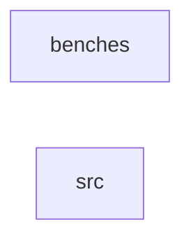

_Generated by CodeAtlas._

## Details

Owns 0 symbols across 1 file(s).

### benches

Owns 8 symbols across 1 file(s).

**Related Classes/Methods:** _None_

**Source Files:**

- `crates/memory/benches/allocator_bench.rs`
  - `crates.memory.benches.allocator_bench.benchmark_alloc_free_cycle`
  - `crates.memory.benches.allocator_bench.benchmark_allocation_latency`
  - `crates.memory.benches.allocator_bench.benchmark_allocation_throughput`
  - `crates.memory.benches.allocator_bench.benchmark_contention_single_size_class`
  - `crates.memory.benches.allocator_bench.benchmark_deallocation_latency`
  - `crates.memory.benches.allocator_bench.benchmark_fragmentation`
  - `crates.memory.benches.allocator_bench.benchmark_large_allocations`
  - `crates.memory.benches.allocator_bench.benchmark_per_cpu_cache_hit`

### src

Owns 153 symbols across 8 file(s).

**Related Classes/Methods:** _None_

**Source Files:**

- `crates/memory/src/allocator.rs`
  - `crates.memory.src.allocator.MemoryAllocator`
  - `crates.memory.src.allocator.MemoryAllocator.allocate`
  - `crates.memory.src.allocator.MemoryAllocator.deallocate`
  - `crates.memory.src.allocator.MemoryAllocator.new`
  - `crates.memory.src.allocator.MemoryAllocator.usage_percent`
  - `crates.memory.src.allocator.tests.allocate_beyond_available_fails`
  - `crates.memory.src.allocator.tests.allocate_reduces_free_and_increases_allocated`
  - `crates.memory.src.allocator.tests.deallocate_returns_memory_to_free_pool`
  - `crates.memory.src.allocator.tests.deallocate_saturates_rather_than_underflows`
  - `crates.memory.src.allocator.tests.usage_percent_reflects_allocation`
- `crates/memory/src/dma.rs`
  - `crates.memory.src.dma.DmaBuffer`
  - `crates.memory.src.dma.DmaManager`
  - `crates.memory.src.dma.DmaManager.allocate_buffer`
  - `crates.memory.src.dma.DmaManager.free_buffer`
  - `crates.memory.src.dma.DmaManager.get_buffer`
  - `crates.memory.src.dma.tests.allocate_buffer_is_retrievable`
  - `crates.memory.src.dma.tests.buffers_get_distinct_physical_addresses`
  - `crates.memory.src.dma.tests.free_buffer_removes_it`
- `crates/memory/src/master_allocator.rs`
  - `crates.memory.src.master_allocator.AllocatorStats`
  - `crates.memory.src.master_allocator.MasterAllocator`
  - `crates.memory.src.master_allocator.MasterAllocator.allocate`
  - `crates.memory.src.master_allocator.MasterAllocator.cpu_count`
  - `crates.memory.src.master_allocator.MasterAllocator.deallocate`
  - `crates.memory.src.master_allocator.MasterAllocator.efficiency_percent`
  - `crates.memory.src.master_allocator.MasterAllocator.maintain`
  - `crates.memory.src.master_allocator.MasterAllocator.new`
  - `crates.memory.src.master_allocator.MasterAllocator.refill_tier0_caches`
  - `crates.memory.src.master_allocator.MasterAllocator.socket_count`
  - `crates.memory.src.master_allocator.MasterAllocator.stats`
  - `crates.memory.src.master_allocator.get_current_socket`
  - `crates.memory.src.master_allocator.tests.test_master_allocator_cycle`
  - `crates.memory.src.master_allocator.tests.test_master_allocator_deallocate_tier0`
  - `crates.memory.src.master_allocator.tests.test_master_allocator_deallocate_tier1`
  - `crates.memory.src.master_allocator.tests.test_master_allocator_efficiency`
  - `crates.memory.src.master_allocator.tests.test_master_allocator_maintain`
  - `crates.memory.src.master_allocator.tests.test_master_allocator_mixed_allocations`
  - `crates.memory.src.master_allocator.tests.test_master_allocator_new`
  - `crates.memory.src.master_allocator.tests.test_master_allocator_out_of_range`
  - `crates.memory.src.master_allocator.tests.test_master_allocator_tier0_allocation`
  - `crates.memory.src.master_allocator.tests.test_master_allocator_tier0_auto_refills_on_fresh_allocator`
  - `crates.memory.src.master_allocator.tests.test_master_allocator_tier1_allocation`
- `crates/memory/src/paging.rs`
  - `crates.memory.src.paging.PageTable`
  - `crates.memory.src.paging.PageTable.map`
  - `crates.memory.src.paging.PageTable.new`
  - `crates.memory.src.paging.PageTable.translate`
  - `crates.memory.src.paging.PageTable.unmap`
  - `crates.memory.src.paging.tests.map_then_translate_round_trips`
  - `crates.memory.src.paging.tests.remapping_overwrites_previous_translation`
  - `crates.memory.src.paging.tests.unmap_removes_mapping`
  - `crates.memory.src.paging.tests.unmapped_address_translates_to_none`
- `crates/memory/src/stress_tests.rs`
  - `crates.memory.src.stress_tests.StressTestConfig`
  - `crates.memory.src.stress_tests.StressTestConfig.default`
  - `crates.memory.src.stress_tests.StressTestResult`
  - `crates.memory.src.stress_tests.stress_test_chaos`
  - `crates.memory.src.stress_tests.stress_test_multithreaded`
  - `crates.memory.src.stress_tests.stress_test_pressure`
  - `crates.memory.src.stress_tests.stress_test_sequential`
  - `crates.memory.src.stress_tests.tests.test_stress_chaos`
  - `crates.memory.src.stress_tests.tests.test_stress_large_allocations`
  - `crates.memory.src.stress_tests.tests.test_stress_multithreaded`
  - `crates.memory.src.stress_tests.tests.test_stress_pressure`
  - `crates.memory.src.stress_tests.tests.test_stress_sequential`
  - `crates.memory.src.stress_tests.tests.test_stress_small_allocations`
- `crates/memory/src/tier0_slab.rs`
  - `crates.memory.src.tier0_slab.CacheStats`
  - `crates.memory.src.tier0_slab.CpuContext`
  - `crates.memory.src.tier0_slab.CpuContext.get`
  - `crates.memory.src.tier0_slab.CpuContext.set`
  - `crates.memory.src.tier0_slab.CpuSlabCache`
  - `crates.memory.src.tier0_slab.CpuSlabCache.allocate`
  - `crates.memory.src.tier0_slab.CpuSlabCache.current_count`
  - `crates.memory.src.tier0_slab.CpuSlabCache.deallocate`
  - `crates.memory.src.tier0_slab.CpuSlabCache.drain_cache`
  - `crates.memory.src.tier0_slab.CpuSlabCache.drop`
  - `crates.memory.src.tier0_slab.CpuSlabCache.is_empty`
  - `crates.memory.src.tier0_slab.CpuSlabCache.is_full`
  - `crates.memory.src.tier0_slab.CpuSlabCache.new`
  - `crates.memory.src.tier0_slab.CpuSlabCache.refill_cache`
  - `crates.memory.src.tier0_slab.SizeClass`
  - `crates.memory.src.tier0_slab.SizeClass.actual_size`
  - `crates.memory.src.tier0_slab.SizeClass.as_index`
  - `crates.memory.src.tier0_slab.SizeClass.from_size`
  - `crates.memory.src.tier0_slab.SizeClass.objects_per_page`
  - `crates.memory.src.tier0_slab.Tier0Allocator`
  - `crates.memory.src.tier0_slab.Tier0Allocator.allocate`
  - `crates.memory.src.tier0_slab.Tier0Allocator.deallocate`
  - `crates.memory.src.tier0_slab.Tier0Allocator.drain_all_caches`
  - `crates.memory.src.tier0_slab.Tier0Allocator.get_cpu_count`
  - `crates.memory.src.tier0_slab.Tier0Allocator.new`
  - `crates.memory.src.tier0_slab.Tier0Allocator.refill_all_caches`
  - `crates.memory.src.tier0_slab.get_cpu_id`
  - `crates.memory.src.tier0_slab.tests.test_cpu_slab_cache_drain`
  - `crates.memory.src.tier0_slab.tests.test_cpu_slab_cache_empty_allocation`
  - `crates.memory.src.tier0_slab.tests.test_cpu_slab_cache_new`
  - `crates.memory.src.tier0_slab.tests.test_size_class_actual_sizes`
  - `crates.memory.src.tier0_slab.tests.test_size_class_objects_per_page`
  - `crates.memory.src.tier0_slab.tests.test_size_class_selection`
  - `crates.memory.src.tier0_slab.tests.test_tier0_allocator_allocate_deallocate_cycle`
  - `crates.memory.src.tier0_slab.tests.test_tier0_allocator_cache_full`
  - `crates.memory.src.tier0_slab.tests.test_tier0_allocator_empty_allocation_auto_refills`
  - `crates.memory.src.tier0_slab.tests.test_tier0_allocator_multiple_size_classes`
  - `crates.memory.src.tier0_slab.tests.test_tier0_allocator_new`
  - `crates.memory.src.tier0_slab.tests.test_tier0_allocator_refill_and_allocate`
- `crates/memory/src/tier1_slab.rs`
  - `crates.memory.src.tier1_slab.CacheStats`
  - `crates.memory.src.tier1_slab.SizeClass`
  - `crates.memory.src.tier1_slab.SizeClass.actual_size`
  - `crates.memory.src.tier1_slab.SizeClass.as_index`
  - `crates.memory.src.tier1_slab.SizeClass.from_size`
  - `crates.memory.src.tier1_slab.SizeClass.objects_per_page`
  - `crates.memory.src.tier1_slab.SizeClass.pages_needed`
  - `crates.memory.src.tier1_slab.SlabPage`
  - `crates.memory.src.tier1_slab.SlabPage.allocate`
  - `crates.memory.src.tier1_slab.SlabPage.allocation_count`
  - `crates.memory.src.tier1_slab.SlabPage.deallocate`
  - `crates.memory.src.tier1_slab.SlabPage.drop`
  - `crates.memory.src.tier1_slab.SlabPage.is_empty`
  - `crates.memory.src.tier1_slab.SlabPage.is_full`
  - `crates.memory.src.tier1_slab.SlabPage.new`
  - `crates.memory.src.tier1_slab.SocketSlabCache`
  - `crates.memory.src.tier1_slab.SocketSlabCache.allocate`
  - `crates.memory.src.tier1_slab.SocketSlabCache.compact`
  - `crates.memory.src.tier1_slab.SocketSlabCache.deallocate`
  - `crates.memory.src.tier1_slab.SocketSlabCache.new`
  - `crates.memory.src.tier1_slab.SocketSlabCache.partial_slab_count`
  - `crates.memory.src.tier1_slab.SocketSlabCache.shrink`
  - `crates.memory.src.tier1_slab.SocketSlabCache.slab_count`
  - `crates.memory.src.tier1_slab.Tier1Allocator`
  - `crates.memory.src.tier1_slab.Tier1Allocator.allocate`
  - `crates.memory.src.tier1_slab.Tier1Allocator.compact_all`
  - `crates.memory.src.tier1_slab.Tier1Allocator.deallocate`
  - `crates.memory.src.tier1_slab.Tier1Allocator.get_socket_count`
  - `crates.memory.src.tier1_slab.Tier1Allocator.new`
  - `crates.memory.src.tier1_slab.Tier1Allocator.shrink_all`
  - `crates.memory.src.tier1_slab.tests.test_cache_shrink_counts_only_destroyed_slabs`
  - `crates.memory.src.tier1_slab.tests.test_colored_slab_objects_stay_in_bounds`
  - `crates.memory.src.tier1_slab.tests.test_size_class_actual_sizes`
  - `crates.memory.src.tier1_slab.tests.test_size_class_selection`
  - `crates.memory.src.tier1_slab.tests.test_slab_page_allocate`
  - `crates.memory.src.tier1_slab.tests.test_slab_page_deallocate`
  - `crates.memory.src.tier1_slab.tests.test_slab_page_full`
  - `crates.memory.src.tier1_slab.tests.test_slab_page_new`
  - `crates.memory.src.tier1_slab.tests.test_slab_page_rejects_double_free_and_bad_offsets`
  - `crates.memory.src.tier1_slab.tests.test_socket_slab_cache_allocate`
  - `crates.memory.src.tier1_slab.tests.test_socket_slab_cache_deallocate`
  - `crates.memory.src.tier1_slab.tests.test_socket_slab_cache_deallocate_probes_non_owning_slab_first`
  - `crates.memory.src.tier1_slab.tests.test_socket_slab_cache_new`
  - `crates.memory.src.tier1_slab.tests.test_tier1_allocator_allocate`
  - `crates.memory.src.tier1_slab.tests.test_tier1_allocator_allocate_deallocate_cycle`
  - `crates.memory.src.tier1_slab.tests.test_tier1_allocator_compact`
  - `crates.memory.src.tier1_slab.tests.test_tier1_allocator_multiple_sizes`
  - `crates.memory.src.tier1_slab.tests.test_tier1_allocator_multiple_sockets`
  - `crates.memory.src.tier1_slab.tests.test_tier1_allocator_new`
  - `crates.memory.src.tier1_slab.tests.test_tier1_allocator_out_of_range`
  - `crates.memory.src.tier1_slab.tests.test_tier1_allocator_shrink`
