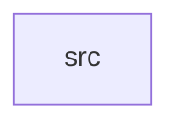

_Generated by CodeAtlas._

## Details

Owns 0 symbols across 1 file(s).

### src

Owns 25 symbols across 4 file(s).

**Related Classes/Methods:** _None_

**Source Files:**

- `crates/networking/src/device.rs`
  - `crates.networking.src.device.NetworkDevice`
  - `crates.networking.src.device.NetworkDevice.new`
  - `crates.networking.src.device.NetworkDevice.with_mtu`
  - `crates.networking.src.device.tests.new_device_defaults_to_1500_mtu`
  - `crates.networking.src.device.tests.with_mtu_overrides_default`
- `crates/networking/src/protocol.rs`
  - `crates.networking.src.protocol.NetworkProtocol`
  - `crates.networking.src.protocol.NetworkProtocol.fmt`
  - `crates.networking.src.protocol.tests.display_labels_are_human_readable`
- `crates/networking/src/stack.rs`
  - `crates.networking.src.stack.DeviceStats`
  - `crates.networking.src.stack.NetworkStack`
  - `crates.networking.src.stack.NetworkStack.device`
  - `crates.networking.src.stack.NetworkStack.device_count`
  - `crates.networking.src.stack.NetworkStack.new`
  - `crates.networking.src.stack.NetworkStack.packets_received`
  - `crates.networking.src.stack.NetworkStack.packets_sent`
  - `crates.networking.src.stack.NetworkStack.receive`
  - `crates.networking.src.stack.NetworkStack.register`
  - `crates.networking.src.stack.NetworkStack.send`
  - `crates.networking.src.stack.NetworkStack.unregister`
  - `crates.networking.src.stack.tests.receive_updates_counters`
  - `crates.networking.src.stack.tests.register_and_lookup`
  - `crates.networking.src.stack.tests.send_over_mtu_is_rejected`
  - `crates.networking.src.stack.tests.send_to_unknown_device_errors`
  - `crates.networking.src.stack.tests.send_within_mtu_updates_counters`
  - `crates.networking.src.stack.tests.unregister_removes_device`
