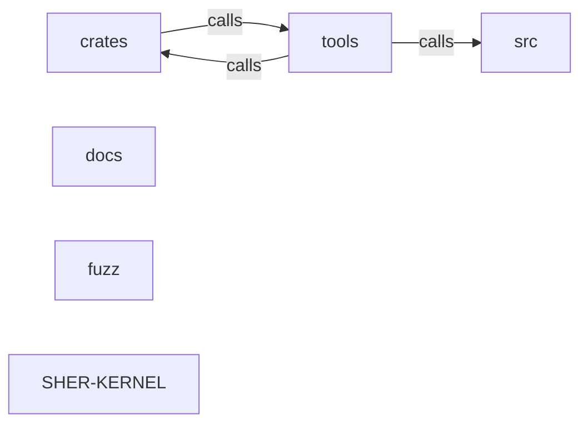

_Generated by CodeAtlas._

## Details

Architecture map of SHER-KERNEL.

### crates

Owns 0 symbols across 0 file(s).

**Related Classes/Methods:** _None_

### docs

Owns 0 symbols across 0 file(s).

**Related Classes/Methods:** _None_

### fuzz

Owns 0 symbols across 2 file(s).

**Related Classes/Methods:** _None_

### src

Owns 0 symbols across 0 file(s).

**Related Classes/Methods:** _None_

### tools

Owns 0 symbols across 0 file(s).

**Related Classes/Methods:** _None_

### SHER-KERNEL

Owns 0 symbols across 12 file(s).

**Related Classes/Methods:** _None_
