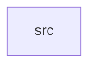

_Generated by CodeAtlas._

## Details

Owns 0 symbols across 1 file(s).

### src

Owns 27 symbols across 1 file(s).

**Related Classes/Methods:** _None_

**Source Files:**

- `crates/performance_benchmarks/src/lib.rs`
  - `crates.performance_benchmarks.src.lib.Benchmark`
  - `crates.performance_benchmarks.src.lib.Benchmark.average_latency_us`
  - `crates.performance_benchmarks.src.lib.Benchmark.default`
  - `crates.performance_benchmarks.src.lib.Benchmark.get_results`
  - `crates.performance_benchmarks.src.lib.Benchmark.measure_memory`
  - `crates.performance_benchmarks.src.lib.Benchmark.measure_operation`
  - `crates.performance_benchmarks.src.lib.Benchmark.measure_throughput`
  - `crates.performance_benchmarks.src.lib.Benchmark.new`
  - `crates.performance_benchmarks.src.lib.Benchmark.record_result`
  - `crates.performance_benchmarks.src.lib.BenchmarkResult`
  - `crates.performance_benchmarks.src.lib.LatencyMeasurement`
  - `crates.performance_benchmarks.src.lib.MemoryMeasurement`
  - `crates.performance_benchmarks.src.lib.ThroughputMeasurement`
  - `crates.performance_benchmarks.src.lib.tests.test_audio_device_registration_latency`
  - `crates.performance_benchmarks.src.lib.tests.test_average_latency_calculation`
  - `crates.performance_benchmarks.src.lib.tests.test_benchmark_creation`
  - `crates.performance_benchmarks.src.lib.tests.test_buffer_allocation_latency`
  - `crates.performance_benchmarks.src.lib.tests.test_gpu_connector_registration_latency`
  - `crates.performance_benchmarks.src.lib.tests.test_input_device_registration_latency`
  - `crates.performance_benchmarks.src.lib.tests.test_measure_operation`
  - `crates.performance_benchmarks.src.lib.tests.test_measure_throughput`
  - `crates.performance_benchmarks.src.lib.tests.test_memory_measurement`
  - `crates.performance_benchmarks.src.lib.tests.test_multi_surface_throughput`
  - `crates.performance_benchmarks.src.lib.tests.test_pointer_event_routing_latency`
  - `crates.performance_benchmarks.src.lib.tests.test_record_and_retrieve_results`
  - `crates.performance_benchmarks.src.lib.tests.test_surface_creation_latency`
  - `crates.performance_benchmarks.src.lib.tests.test_wayland_client_connection_latency`
