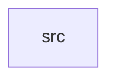

_Generated by CodeAtlas._

## Details

Owns 0 symbols across 1 file(s).

### src

Owns 47 symbols across 1 file(s).

**Related Classes/Methods:** _None_

**Source Files:**

- `crates/performance_optimization/src/lib.rs`
  - `crates.performance_optimization.src.lib.Batch`
  - `crates.performance_optimization.src.lib.Batch.add`
  - `crates.performance_optimization.src.lib.Batch.current_size`
  - `crates.performance_optimization.src.lib.Batch.flush`
  - `crates.performance_optimization.src.lib.Batch.is_empty`
  - `crates.performance_optimization.src.lib.Batch.is_full`
  - `crates.performance_optimization.src.lib.Batch.new`
  - `crates.performance_optimization.src.lib.Cache`
  - `crates.performance_optimization.src.lib.Cache.clear`
  - `crates.performance_optimization.src.lib.Cache.get`
  - `crates.performance_optimization.src.lib.Cache.hit_rate`
  - `crates.performance_optimization.src.lib.Cache.new`
  - `crates.performance_optimization.src.lib.Cache.put`
  - `crates.performance_optimization.src.lib.Cache.size`
  - `crates.performance_optimization.src.lib.CacheEntry`
  - `crates.performance_optimization.src.lib.ObjectPool`
  - `crates.performance_optimization.src.lib.ObjectPool.acquire`
  - `crates.performance_optimization.src.lib.ObjectPool.available_count`
  - `crates.performance_optimization.src.lib.ObjectPool.in_use_count`
  - `crates.performance_optimization.src.lib.ObjectPool.max_size`
  - `crates.performance_optimization.src.lib.ObjectPool.new`
  - `crates.performance_optimization.src.lib.ObjectPool.release`
  - `crates.performance_optimization.src.lib.ObjectPool.utilization`
  - `crates.performance_optimization.src.lib.PerformanceOptimizer`
  - `crates.performance_optimization.src.lib.PerformanceOptimizer.batch_size_avg`
  - `crates.performance_optimization.src.lib.PerformanceOptimizer.cache_hit_rate`
  - `crates.performance_optimization.src.lib.PerformanceOptimizer.default`
  - `crates.performance_optimization.src.lib.PerformanceOptimizer.get_optimization_score`
  - `crates.performance_optimization.src.lib.PerformanceOptimizer.new`
  - `crates.performance_optimization.src.lib.PerformanceOptimizer.pool_utilization`
  - `crates.performance_optimization.src.lib.PerformanceOptimizer.record_metrics`
  - `crates.performance_optimization.src.lib.PooledResource`
  - `crates.performance_optimization.src.lib.tests.test_batch_add_and_flush`
  - `crates.performance_optimization.src.lib.tests.test_batch_flush_on_full`
  - `crates.performance_optimization.src.lib.tests.test_batch_full_detection`
  - `crates.performance_optimization.src.lib.tests.test_batch_processing_workflow`
  - `crates.performance_optimization.src.lib.tests.test_cache_clear`
  - `crates.performance_optimization.src.lib.tests.test_cache_eviction`
  - `crates.performance_optimization.src.lib.tests.test_cache_hit_and_miss`
  - `crates.performance_optimization.src.lib.tests.test_cache_with_multiple_keys`
  - `crates.performance_optimization.src.lib.tests.test_object_pool_acquire_and_release`
  - `crates.performance_optimization.src.lib.tests.test_object_pool_creation`
  - `crates.performance_optimization.src.lib.tests.test_object_pool_utilization`
  - `crates.performance_optimization.src.lib.tests.test_optimization_score`
  - `crates.performance_optimization.src.lib.tests.test_performance_optimizer_metrics`
  - `crates.performance_optimization.src.lib.tests.test_pool_multiple_acquire_and_release`
  - `crates.performance_optimization.src.lib.tests.test_pool_respects_max_size_capacity`
