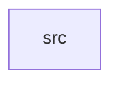

_Generated by CodeAtlas._

## Details

Owns 0 symbols across 1 file(s).

### src

Owns 79 symbols across 6 file(s).

**Related Classes/Methods:** _None_

**Source Files:**

- `crates/recovery/src/bootptr.rs`
  - `crates.recovery.src.bootptr.BootPointer`
  - `crates.recovery.src.bootptr.BootPointer.active`
  - `crates.recovery.src.bootptr.BootPointer.default`
  - `crates.recovery.src.bootptr.BootPointer.history`
  - `crates.recovery.src.bootptr.BootPointer.new`
  - `crates.recovery.src.bootptr.BootPointer.rollback`
  - `crates.recovery.src.bootptr.BootPointer.switch_to`
  - `crates.recovery.src.bootptr.BootSwitch`
  - `crates.recovery.src.bootptr.tests.defaults_to_slot_a`
  - `crates.recovery.src.bootptr.tests.rollback_flips_to_other_slot`
  - `crates.recovery.src.bootptr.tests.switch_to_updates_active_and_records_history`
- `crates/recovery/src/crash_recovery.rs`
  - `crates.recovery.src.crash_recovery.CrashMetrics`
  - `crates.recovery.src.crash_recovery.CrashRecoveryManager`
  - `crates.recovery.src.crash_recovery.CrashRecoveryManager.calculate_backoff`
  - `crates.recovery.src.crash_recovery.CrashRecoveryManager.current_time`
  - `crates.recovery.src.crash_recovery.CrashRecoveryManager.get_metrics`
  - `crates.recovery.src.crash_recovery.CrashRecoveryManager.get_recovery_state`
  - `crates.recovery.src.crash_recovery.CrashRecoveryManager.health_check`
  - `crates.recovery.src.crash_recovery.CrashRecoveryManager.is_quarantined`
  - `crates.recovery.src.crash_recovery.CrashRecoveryManager.new`
  - `crates.recovery.src.crash_recovery.CrashRecoveryManager.quarantine_driver`
  - `crates.recovery.src.crash_recovery.CrashRecoveryManager.record_crash`
  - `crates.recovery.src.crash_recovery.CrashRecoveryManager.record_failed_recovery`
  - `crates.recovery.src.crash_recovery.CrashRecoveryManager.record_recovery_attempt`
  - `crates.recovery.src.crash_recovery.CrashRecoveryManager.record_successful_recovery`
  - `crates.recovery.src.crash_recovery.CrashRecoveryManager.release_quarantine`
  - `crates.recovery.src.crash_recovery.CrashRecoveryManager.reset_metrics`
  - `crates.recovery.src.crash_recovery.CrashRecoveryManager.should_recover`
  - `crates.recovery.src.crash_recovery.RecoveryPolicy`
  - `crates.recovery.src.crash_recovery.RecoveryPolicy.default`
  - `crates.recovery.src.crash_recovery.RecoveryState`
  - `crates.recovery.src.crash_recovery.tests.test_crash_detection`
  - `crates.recovery.src.crash_recovery.tests.test_exponential_backoff`
  - `crates.recovery.src.crash_recovery.tests.test_health_check`
  - `crates.recovery.src.crash_recovery.tests.test_quarantine_threshold`
  - `crates.recovery.src.crash_recovery.tests.test_recovery_limits`
  - `crates.recovery.src.crash_recovery.tests.test_reset_metrics`
- `crates/recovery/src/healthcheck.rs`
  - `crates.recovery.src.healthcheck.HealthCheckReport`
  - `crates.recovery.src.healthcheck.HealthCheckReport.all_passed`
  - `crates.recovery.src.healthcheck.HealthCheckReport.failures`
  - `crates.recovery.src.healthcheck.ProbeResult`
  - `crates.recovery.src.healthcheck.check`
  - `crates.recovery.src.healthcheck.check_default`
  - `crates.recovery.src.healthcheck.probe_integrity`
  - `crates.recovery.src.healthcheck.probe_not_empty`
  - `crates.recovery.src.healthcheck.tests.empty_partition_fails_health_check`
  - `crates.recovery.src.healthcheck.tests.staged_partition_passes_health_check`
- `crates/recovery/src/partition.rs`
  - `crates.recovery.src.partition.ImmutablePartition`
  - `crates.recovery.src.partition.ImmutablePartition.checksum_of`
  - `crates.recovery.src.partition.ImmutablePartition.empty`
  - `crates.recovery.src.partition.ImmutablePartition.image_len`
  - `crates.recovery.src.partition.ImmutablePartition.is_empty`
  - `crates.recovery.src.partition.ImmutablePartition.verify`
  - `crates.recovery.src.partition.ImmutablePartition.write_image`
  - `crates.recovery.src.partition.PartitionSlot`
  - `crates.recovery.src.partition.PartitionSlot.other`
  - `crates.recovery.src.partition.tests.empty_partition_is_not_verified`
  - `crates.recovery.src.partition.tests.other_slot_flips`
  - `crates.recovery.src.partition.tests.written_image_verifies`
- `crates/recovery/src/watchdog.rs`
  - `crates.recovery.src.watchdog.HealthStatus`
  - `crates.recovery.src.watchdog.HeartbeatRecord`
  - `crates.recovery.src.watchdog.Watchdog`
  - `crates.recovery.src.watchdog.Watchdog.check_all_health`
  - `crates.recovery.src.watchdog.Watchdog.check_health`
  - `crates.recovery.src.watchdog.Watchdog.current_time`
  - `crates.recovery.src.watchdog.Watchdog.get_statistics`
  - `crates.recovery.src.watchdog.Watchdog.get_status`
  - `crates.recovery.src.watchdog.Watchdog.new`
  - `crates.recovery.src.watchdog.Watchdog.record_heartbeat`
  - `crates.recovery.src.watchdog.Watchdog.register_alert_callback`
  - `crates.recovery.src.watchdog.Watchdog.register_heartbeat`
  - `crates.recovery.src.watchdog.Watchdog.trigger_alerts`
  - `crates.recovery.src.watchdog.Watchdog.unregister_driver`
  - `crates.recovery.src.watchdog.WatchdogStats`
  - `crates.recovery.src.watchdog.tests.test_degraded_status`
  - `crates.recovery.src.watchdog.tests.test_heartbeat_recording`
  - `crates.recovery.src.watchdog.tests.test_heartbeat_registration`
  - `crates.recovery.src.watchdog.tests.test_multiple_drivers`
  - `crates.recovery.src.watchdog.tests.test_unregister_driver`
