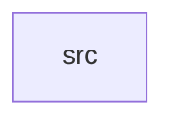

_Generated by CodeAtlas._

## Details

Owns 0 symbols across 1 file(s).

### src

Owns 46 symbols across 1 file(s).

**Related Classes/Methods:** _None_

**Source Files:**

- `crates/release_engineering/src/lib.rs`
  - `crates.release_engineering.src.lib.ChangeLogEntry`
  - `crates.release_engineering.src.lib.ChangeType`
  - `crates.release_engineering.src.lib.ReleaseArtifact`
  - `crates.release_engineering.src.lib.ReleaseManager`
  - `crates.release_engineering.src.lib.ReleaseManager.add_changelog_entry`
  - `crates.release_engineering.src.lib.ReleaseManager.all_gates_passed`
  - `crates.release_engineering.src.lib.ReleaseManager.changelog_summary`
  - `crates.release_engineering.src.lib.ReleaseManager.default`
  - `crates.release_engineering.src.lib.ReleaseManager.gate_status`
  - `crates.release_engineering.src.lib.ReleaseManager.get_artifacts`
  - `crates.release_engineering.src.lib.ReleaseManager.get_changelog`
  - `crates.release_engineering.src.lib.ReleaseManager.get_feature_count`
  - `crates.release_engineering.src.lib.ReleaseManager.get_security_fix_count`
  - `crates.release_engineering.src.lib.ReleaseManager.get_status`
  - `crates.release_engineering.src.lib.ReleaseManager.get_version`
  - `crates.release_engineering.src.lib.ReleaseManager.has_breaking_changes`
  - `crates.release_engineering.src.lib.ReleaseManager.is_release_ready`
  - `crates.release_engineering.src.lib.ReleaseManager.new`
  - `crates.release_engineering.src.lib.ReleaseManager.register_artifact`
  - `crates.release_engineering.src.lib.ReleaseManager.set_quality_gate`
  - `crates.release_engineering.src.lib.ReleaseManager.set_status`
  - `crates.release_engineering.src.lib.ReleaseManager.set_version`
  - `crates.release_engineering.src.lib.ReleaseManager.total_artifact_size`
  - `crates.release_engineering.src.lib.ReleaseManager.total_artifacts`
  - `crates.release_engineering.src.lib.ReleaseStatus`
  - `crates.release_engineering.src.lib.Version`
  - `crates.release_engineering.src.lib.Version.bump_major`
  - `crates.release_engineering.src.lib.Version.bump_minor`
  - `crates.release_engineering.src.lib.Version.bump_patch`
  - `crates.release_engineering.src.lib.Version.fmt`
  - `crates.release_engineering.src.lib.Version.new`
  - `crates.release_engineering.src.lib.tests.test_breaking_changes`
  - `crates.release_engineering.src.lib.tests.test_changelog_entries`
  - `crates.release_engineering.src.lib.tests.test_changelog_for_version`
  - `crates.release_engineering.src.lib.tests.test_feature_and_security_counts`
  - `crates.release_engineering.src.lib.tests.test_multiple_artifacts`
  - `crates.release_engineering.src.lib.tests.test_quality_gate_failure`
  - `crates.release_engineering.src.lib.tests.test_quality_gates`
  - `crates.release_engineering.src.lib.tests.test_release_artifacts`
  - `crates.release_engineering.src.lib.tests.test_release_manager_creation`
  - `crates.release_engineering.src.lib.tests.test_release_readiness`
  - `crates.release_engineering.src.lib.tests.test_release_status_transitions`
  - `crates.release_engineering.src.lib.tests.test_version_bumping`
  - `crates.release_engineering.src.lib.tests.test_version_comparison`
  - `crates.release_engineering.src.lib.tests.test_version_creation`
  - `crates.release_engineering.src.lib.tests.test_version_to_string`
