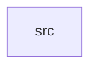

_Generated by CodeAtlas._

## Details

Owns 0 symbols across 1 file(s).

### src

Owns 13 symbols across 1 file(s).

**Related Classes/Methods:** _None_

**Source Files:**

- `crates/runtime/src/lib.rs`
  - `crates.runtime.src.lib.ServiceDescriptor`
  - `crates.runtime.src.lib.ServiceRegistry`
  - `crates.runtime.src.lib.ServiceRegistry.default`
  - `crates.runtime.src.lib.ServiceRegistry.is_loaded`
  - `crates.runtime.src.lib.ServiceRegistry.is_registered`
  - `crates.runtime.src.lib.ServiceRegistry.load_service`
  - `crates.runtime.src.lib.ServiceRegistry.loaded_services`
  - `crates.runtime.src.lib.ServiceRegistry.new`
  - `crates.runtime.src.lib.ServiceRegistry.register`
  - `crates.runtime.src.lib.tests.descriptor`
  - `crates.runtime.src.lib.tests.loading_twice_is_idempotent`
  - `crates.runtime.src.lib.tests.loading_unregistered_service_errors`
  - `crates.runtime.src.lib.tests.registered_service_loads_and_is_tracked`
