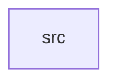

_Generated by CodeAtlas._

## Details

Owns 0 symbols across 1 file(s).

### src

Owns 30 symbols across 5 file(s).

**Related Classes/Methods:** _None_

**Source Files:**

- `crates/scheduler/src/heterogeneous.rs`
  - `crates.scheduler.src.heterogeneous.ComputeTarget`
  - `crates.scheduler.src.heterogeneous.ComputeTarget.fmt`
  - `crates.scheduler.src.heterogeneous.tests.display_matches_expected_labels`
  - `crates.scheduler.src.heterogeneous.tests.targets_are_hashable_and_distinct`
- `crates/scheduler/src/queue.rs`
  - `crates.scheduler.src.queue.TaskQueue`
  - `crates.scheduler.src.queue.TaskQueue.dequeue`
  - `crates.scheduler.src.queue.TaskQueue.enqueue`
  - `crates.scheduler.src.queue.TaskQueue.is_empty`
  - `crates.scheduler.src.queue.TaskQueue.len`
  - `crates.scheduler.src.queue.tests.enqueue_dequeue_is_fifo`
  - `crates.scheduler.src.queue.tests.is_empty_reflects_state`
- `crates/scheduler/src/scheduler.rs`
  - `crates.scheduler.src.scheduler.Scheduler`
  - `crates.scheduler.src.scheduler.Scheduler.complete`
  - `crates.scheduler.src.scheduler.Scheduler.completed_count`
  - `crates.scheduler.src.scheduler.Scheduler.dispatch_next`
  - `crates.scheduler.src.scheduler.Scheduler.fail`
  - `crates.scheduler.src.scheduler.Scheduler.failed_count`
  - `crates.scheduler.src.scheduler.Scheduler.new`
  - `crates.scheduler.src.scheduler.Scheduler.pending_count`
  - `crates.scheduler.src.scheduler.Scheduler.running_count`
  - `crates.scheduler.src.scheduler.Scheduler.submit`
  - `crates.scheduler.src.scheduler.tests.complete_and_fail_move_task_out_of_running`
  - `crates.scheduler.src.scheduler.tests.completing_unknown_task_returns_false`
  - `crates.scheduler.src.scheduler.tests.dispatches_highest_priority_first`
  - `crates.scheduler.src.scheduler.tests.targets_are_scheduled_independently`
  - `crates.scheduler.src.scheduler.tests.ties_broken_fifo`
- `crates/scheduler/src/task.rs`
  - `crates.scheduler.src.task.Task`
  - `crates.scheduler.src.task.Task.new`
  - `crates.scheduler.src.task.TaskState`
  - `crates.scheduler.src.task.tests.new_task_starts_pending_with_unique_id`
