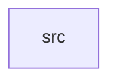

_Generated by CodeAtlas._

## Details

Owns 0 symbols across 1 file(s).

### src

Owns 23 symbols across 4 file(s).

**Related Classes/Methods:** _None_

**Source Files:**

- `crates/security/src/audit.rs`
  - `crates.security.src.audit.AuditEvent`
  - `crates.security.src.audit.AuditLog`
  - `crates.security.src.audit.AuditLog.events_by_actor`
  - `crates.security.src.audit.AuditLog.failed_events`
  - `crates.security.src.audit.AuditLog.log`
  - `crates.security.src.audit.tests.events_by_actor_filters_correctly`
  - `crates.security.src.audit.tests.failed_events_filters_correctly`
  - `crates.security.src.audit.tests.log_appends_event_with_timestamp`
- `crates/security/src/capabilities.rs`
  - `crates.security.src.capabilities.SecurityContext`
  - `crates.security.src.capabilities.SecurityContext.grant`
  - `crates.security.src.capabilities.SecurityContext.has_capability`
  - `crates.security.src.capabilities.SecurityContext.new`
  - `crates.security.src.capabilities.SecurityContext.revoke`
  - `crates.security.src.capabilities.tests.grant_is_idempotent`
  - `crates.security.src.capabilities.tests.new_context_has_no_capabilities_and_audit_on`
  - `crates.security.src.capabilities.tests.revoke_removes_capability`
- `crates/security/src/isolation.rs`
  - `crates.security.src.isolation.Sandbox`
  - `crates.security.src.isolation.Sandbox.allow_filesystem`
  - `crates.security.src.isolation.Sandbox.allow_network`
  - `crates.security.src.isolation.Sandbox.is_fully_locked_down`
  - `crates.security.src.isolation.Sandbox.new`
  - `crates.security.src.isolation.tests.allow_methods_opt_in_to_access`
  - `crates.security.src.isolation.tests.new_sandbox_denies_by_default`
