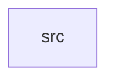

_Generated by CodeAtlas._

## Details

Owns 0 symbols across 1 file(s).

### src

Owns 48 symbols across 1 file(s).

**Related Classes/Methods:** _None_

**Source Files:**

- `crates/security_audit/src/lib.rs`
  - `crates.security_audit.src.lib.CapabilityValidator`
  - `crates.security_audit.src.lib.CapabilityValidator.default`
  - `crates.security_audit.src.lib.CapabilityValidator.expire_capabilities`
  - `crates.security_audit.src.lib.CapabilityValidator.grant_capability`
  - `crates.security_audit.src.lib.CapabilityValidator.has_capability`
  - `crates.security_audit.src.lib.CapabilityValidator.new`
  - `crates.security_audit.src.lib.CapabilityValidator.revoke_capability`
  - `crates.security_audit.src.lib.InputValidator`
  - `crates.security_audit.src.lib.InputValidator.add_rule`
  - `crates.security_audit.src.lib.InputValidator.default`
  - `crates.security_audit.src.lib.InputValidator.new`
  - `crates.security_audit.src.lib.InputValidator.validate`
  - `crates.security_audit.src.lib.MemorySafetyCheck`
  - `crates.security_audit.src.lib.SecurityAudit`
  - `crates.security_audit.src.lib.SecurityAudit.add_validation_rule`
  - `crates.security_audit.src.lib.SecurityAudit.critical_event_count`
  - `crates.security_audit.src.lib.SecurityAudit.default`
  - `crates.security_audit.src.lib.SecurityAudit.enforce_capability`
  - `crates.security_audit.src.lib.SecurityAudit.get_events`
  - `crates.security_audit.src.lib.SecurityAudit.get_threat_score`
  - `crates.security_audit.src.lib.SecurityAudit.grant_capability`
  - `crates.security_audit.src.lib.SecurityAudit.log_event`
  - `crates.security_audit.src.lib.SecurityAudit.new`
  - `crates.security_audit.src.lib.SecurityAudit.owning_allocation`
  - `crates.security_audit.src.lib.SecurityAudit.register_memory_check`
  - `crates.security_audit.src.lib.SecurityAudit.security_status`
  - `crates.security_audit.src.lib.SecurityAudit.total_guard_pages`
  - `crates.security_audit.src.lib.SecurityAudit.validate_input`
  - `crates.security_audit.src.lib.SecurityAudit.validate_memory_access`
  - `crates.security_audit.src.lib.SecurityEvent`
  - `crates.security_audit.src.lib.ThreatLevel`
  - `crates.security_audit.src.lib.ValidationRule`
  - `crates.security_audit.src.lib.tests.test_audit_capability_enforcement_logs_denial`
  - `crates.security_audit.src.lib.tests.test_audit_delegates_input_validation`
  - `crates.security_audit.src.lib.tests.test_audit_trail_completeness`
  - `crates.security_audit.src.lib.tests.test_capability_expiration`
  - `crates.security_audit.src.lib.tests.test_capability_grant_and_check`
  - `crates.security_audit.src.lib.tests.test_capability_revocation`
  - `crates.security_audit.src.lib.tests.test_comprehensive_security_scenario`
  - `crates.security_audit.src.lib.tests.test_critical_threat_scoring`
  - `crates.security_audit.src.lib.tests.test_input_validator_character_check`
  - `crates.security_audit.src.lib.tests.test_input_validator_length_check`
  - `crates.security_audit.src.lib.tests.test_input_validator_pattern_rejection`
  - `crates.security_audit.src.lib.tests.test_memory_safety_check`
  - `crates.security_audit.src.lib.tests.test_owning_allocation_and_guard_pages`
  - `crates.security_audit.src.lib.tests.test_security_audit_creation`
  - `crates.security_audit.src.lib.tests.test_security_event_logging`
  - `crates.security_audit.src.lib.tests.test_threat_level_assessment`
