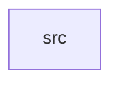

_Generated by CodeAtlas._

## Details

Owns 0 symbols across 1 file(s).

### src

Owns 23 symbols across 7 file(s).

**Related Classes/Methods:** _None_

**Source Files:**

- `crates/services/src/audio.rs`
  - `crates.services.src.audio.Service`
- `crates/services/src/display.rs`
  - `crates.services.src.display.Service`
- `crates/services/src/filesystem.rs`
  - `crates.services.src.filesystem.Service`
- `crates/services/src/manager.rs`
  - `crates.services.src.manager.Profile`
  - `crates.services.src.manager.Profile.default_services`
  - `crates.services.src.manager.ServiceKind`
  - `crates.services.src.manager.ServiceManager`
  - `crates.services.src.manager.ServiceManager.apply_profile`
  - `crates.services.src.manager.ServiceManager.is_loaded`
  - `crates.services.src.manager.ServiceManager.load`
  - `crates.services.src.manager.ServiceManager.loaded_services`
  - `crates.services.src.manager.ServiceManager.new`
  - `crates.services.src.manager.ServiceManager.state`
  - `crates.services.src.manager.ServiceManager.unload`
  - `crates.services.src.manager.ServiceState`
  - `crates.services.src.manager.tests.headless_profile_is_minimal`
  - `crates.services.src.manager.tests.load_is_idempotent`
  - `crates.services.src.manager.tests.on_demand_load_can_happen_outside_profile`
  - `crates.services.src.manager.tests.server_profile_never_loads_display_or_audio`
  - `crates.services.src.manager.tests.unload_resets_state`
  - `crates.services.src.manager.tests.workstation_profile_loads_everything`
- `crates/services/src/networking.rs`
  - `crates.services.src.networking.Service`
- `crates/services/src/storage.rs`
  - `crates.services.src.storage.Service`
