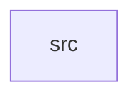

_Generated by CodeAtlas._

## Details

Owns 0 symbols across 1 file(s).

### src

Owns 25 symbols across 4 file(s).

**Related Classes/Methods:** _None_

**Source Files:**

- `crates/snapshot/src/restore.rs`
  - `crates.snapshot.src.restore.restore`
  - `crates.snapshot.src.restore.restore_previous`
  - `crates.snapshot.src.restore.tests.restore_previous_at_oldest_version_errors`
  - `crates.snapshot.src.restore.tests.restore_previous_steps_back_one_version`
  - `crates.snapshot.src.restore.tests.restore_switches_active_version`
  - `crates.snapshot.src.restore.tests.restore_unknown_version_errors`
- `crates/snapshot/src/store.rs`
  - `crates.snapshot.src.store.SnapshotStore`
  - `crates.snapshot.src.store.SnapshotStore.activate`
  - `crates.snapshot.src.store.SnapshotStore.active`
  - `crates.snapshot.src.store.SnapshotStore.active_version`
  - `crates.snapshot.src.store.SnapshotStore.create`
  - `crates.snapshot.src.store.SnapshotStore.get`
  - `crates.snapshot.src.store.SnapshotStore.new`
  - `crates.snapshot.src.store.SnapshotStore.versions`
  - `crates.snapshot.src.store.tests.activate_rolls_back_without_reinstall`
  - `crates.snapshot.src.store.tests.activate_unknown_version_fails`
  - `crates.snapshot.src.store.tests.active_returns_matching_snapshot`
  - `crates.snapshot.src.store.tests.create_sets_active_version`
  - `crates.snapshot.src.store.tests.old_versions_coexist_after_new_create`
- `crates/snapshot/src/version.rs`
  - `crates.snapshot.src.version.Snapshot`
  - `crates.snapshot.src.version.Snapshot.checksum_of`
  - `crates.snapshot.src.version.Snapshot.is_intact`
  - `crates.snapshot.src.version.Snapshot.new`
  - `crates.snapshot.src.version.tests.new_snapshot_is_intact`
  - `crates.snapshot.src.version.tests.tampering_breaks_integrity_check`
