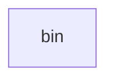

_Generated by CodeAtlas._

## Details

Owns 0 symbols across 0 file(s).

### bin

Owns 5 symbols across 1 file(s).

**Related Classes/Methods:** _None_

**Source Files:**

- `src/bin/sher-kernel.rs`
  - `src.bin.sher-kernel.main`
  - `src.bin.sher-kernel.print_help`
  - `src.bin.sher-kernel.print_info`
  - `src.bin.sher-kernel.print_status`
  - `src.bin.sher-kernel.print_welcome`
