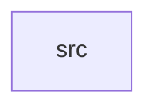

_Generated by CodeAtlas._

## Details

Owns 0 symbols across 1 file(s).

### src

Owns 29 symbols across 4 file(s).

**Related Classes/Methods:** _None_

**Source Files:**

- `crates/storage/src/blockdevice.rs`
  - `crates.storage.src.blockdevice.BlockDevice`
  - `crates.storage.src.blockdevice.BlockDevice.new`
  - `crates.storage.src.blockdevice.BlockDevice.read_count`
  - `crates.storage.src.blockdevice.BlockDevice.read_sector`
  - `crates.storage.src.blockdevice.BlockDevice.sector_range`
  - `crates.storage.src.blockdevice.BlockDevice.total_size`
  - `crates.storage.src.blockdevice.BlockDevice.write_count`
  - `crates.storage.src.blockdevice.BlockDevice.write_sector`
  - `crates.storage.src.blockdevice.tests.new_device_reads_as_zeroed`
  - `crates.storage.src.blockdevice.tests.out_of_range_sector_is_rejected`
  - `crates.storage.src.blockdevice.tests.write_then_read_round_trips`
  - `crates.storage.src.blockdevice.tests.wrong_size_write_is_rejected`
- `crates/storage/src/device.rs`
  - `crates.storage.src.device.StorageDevice`
  - `crates.storage.src.device.StorageDevice.new`
  - `crates.storage.src.device.tests.new_device_has_unique_id_and_stored_fields`
- `crates/storage/src/registry.rs`
  - `crates.storage.src.registry.StorageRegistry`
  - `crates.storage.src.registry.StorageRegistry.block_device_mut`
  - `crates.storage.src.registry.StorageRegistry.get`
  - `crates.storage.src.registry.StorageRegistry.is_empty`
  - `crates.storage.src.registry.StorageRegistry.len`
  - `crates.storage.src.registry.StorageRegistry.new`
  - `crates.storage.src.registry.StorageRegistry.register`
  - `crates.storage.src.registry.StorageRegistry.total_capacity`
  - `crates.storage.src.registry.StorageRegistry.unregister`
  - `crates.storage.src.registry.StorageRegistry.write_sector`
  - `crates.storage.src.registry.tests.register_and_lookup`
  - `crates.storage.src.registry.tests.total_capacity_sums_devices`
  - `crates.storage.src.registry.tests.unregister_removes_device`
  - `crates.storage.src.registry.tests.write_sector_through_registry`
