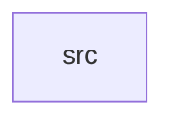

_Generated by CodeAtlas._

## Details

Owns 0 symbols across 1 file(s).

### src

Owns 37 symbols across 1 file(s).

**Related Classes/Methods:** _None_

**Source Files:**

- `crates/system_integration/src/lib.rs`
  - `crates.system_integration.src.lib.ApplicationStack`
  - `crates.system_integration.src.lib.ApplicationStack.default`
  - `crates.system_integration.src.lib.ApplicationStack.get_audio_driver`
  - `crates.system_integration.src.lib.ApplicationStack.get_audio_driver_mut`
  - `crates.system_integration.src.lib.ApplicationStack.get_compositor`
  - `crates.system_integration.src.lib.ApplicationStack.get_compositor_mut`
  - `crates.system_integration.src.lib.ApplicationStack.get_device_manager`
  - `crates.system_integration.src.lib.ApplicationStack.get_device_manager_mut`
  - `crates.system_integration.src.lib.ApplicationStack.get_gpu_driver`
  - `crates.system_integration.src.lib.ApplicationStack.get_gpu_driver_mut`
  - `crates.system_integration.src.lib.ApplicationStack.get_input_driver`
  - `crates.system_integration.src.lib.ApplicationStack.get_input_driver_mut`
  - `crates.system_integration.src.lib.ApplicationStack.initialize`
  - `crates.system_integration.src.lib.ApplicationStack.new`
  - `crates.system_integration.src.lib.ApplicationStack.shutdown`
  - `crates.system_integration.src.lib.ApplicationStack.total_resources`
  - `crates.system_integration.src.lib.tests.test_audio_device_setup`
  - `crates.system_integration.src.lib.tests.test_audio_playback_integration`
  - `crates.system_integration.src.lib.tests.test_aurora_theme_application`
  - `crates.system_integration.src.lib.tests.test_complete_workflow`
  - `crates.system_integration.src.lib.tests.test_concurrent_app_rendering`
  - `crates.system_integration.src.lib.tests.test_device_manager_coordination`
  - `crates.system_integration.src.lib.tests.test_error_isolation`
  - `crates.system_integration.src.lib.tests.test_full_stack_performance`
  - `crates.system_integration.src.lib.tests.test_gpu_display_setup`
  - `crates.system_integration.src.lib.tests.test_gtk4_widget_rendering`
  - `crates.system_integration.src.lib.tests.test_himalayas_browser_launch`
  - `crates.system_integration.src.lib.tests.test_input_event_pipeline`
  - `crates.system_integration.src.lib.tests.test_input_event_routing`
  - `crates.system_integration.src.lib.tests.test_multi_app_scenario`
  - `crates.system_integration.src.lib.tests.test_multi_display_setup`
  - `crates.system_integration.src.lib.tests.test_pointer_focus_sync`
  - `crates.system_integration.src.lib.tests.test_resource_accounting`
  - `crates.system_integration.src.lib.tests.test_stack_initialization`
  - `crates.system_integration.src.lib.tests.test_stack_shutdown`
  - `crates.system_integration.src.lib.tests.test_surface_rendering_pipeline`
  - `crates.system_integration.src.lib.tests.test_wayland_client_lifecycle`
