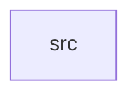

_Generated by CodeAtlas._

## Details

Owns 0 symbols across 1 file(s).

### src

Owns 36 symbols across 1 file(s).

**Related Classes/Methods:** _None_

**Source Files:**

- `crates/unified_device_manager/src/lib.rs`
  - `crates.unified_device_manager.src.lib.DeviceState`
  - `crates.unified_device_manager.src.lib.UnifiedDeviceManager`
  - `crates.unified_device_manager.src.lib.UnifiedDeviceManager.all_devices_healthy`
  - `crates.unified_device_manager.src.lib.UnifiedDeviceManager.broadcast_hotplug`
  - `crates.unified_device_manager.src.lib.UnifiedDeviceManager.default`
  - `crates.unified_device_manager.src.lib.UnifiedDeviceManager.event_log_len`
  - `crates.unified_device_manager.src.lib.UnifiedDeviceManager.get_audio_device`
  - `crates.unified_device_manager.src.lib.UnifiedDeviceManager.get_audio_device_count`
  - `crates.unified_device_manager.src.lib.UnifiedDeviceManager.get_event_log`
  - `crates.unified_device_manager.src.lib.UnifiedDeviceManager.get_gpu_device`
  - `crates.unified_device_manager.src.lib.UnifiedDeviceManager.get_gpu_device_count`
  - `crates.unified_device_manager.src.lib.UnifiedDeviceManager.get_healthy_device_count`
  - `crates.unified_device_manager.src.lib.UnifiedDeviceManager.get_input_device`
  - `crates.unified_device_manager.src.lib.UnifiedDeviceManager.get_input_device_count`
  - `crates.unified_device_manager.src.lib.UnifiedDeviceManager.get_total_device_count`
  - `crates.unified_device_manager.src.lib.UnifiedDeviceManager.initialize`
  - `crates.unified_device_manager.src.lib.UnifiedDeviceManager.is_initialized`
  - `crates.unified_device_manager.src.lib.UnifiedDeviceManager.log_event`
  - `crates.unified_device_manager.src.lib.UnifiedDeviceManager.mark_device_healthy`
  - `crates.unified_device_manager.src.lib.UnifiedDeviceManager.new`
  - `crates.unified_device_manager.src.lib.UnifiedDeviceManager.register_audio_device`
  - `crates.unified_device_manager.src.lib.UnifiedDeviceManager.register_gpu_device`
  - `crates.unified_device_manager.src.lib.UnifiedDeviceManager.register_input_device`
  - `crates.unified_device_manager.src.lib.UnifiedDeviceManager.report_device_error`
  - `crates.unified_device_manager.src.lib.tests.test_all_devices_healthy`
  - `crates.unified_device_manager.src.lib.tests.test_device_health_tracking`
  - `crates.unified_device_manager.src.lib.tests.test_device_unhealthy_threshold`
  - `crates.unified_device_manager.src.lib.tests.test_event_logging`
  - `crates.unified_device_manager.src.lib.tests.test_hotplug_broadcast`
  - `crates.unified_device_manager.src.lib.tests.test_initialization`
  - `crates.unified_device_manager.src.lib.tests.test_manager_creation`
  - `crates.unified_device_manager.src.lib.tests.test_mark_device_healthy`
  - `crates.unified_device_manager.src.lib.tests.test_multiple_device_types`
  - `crates.unified_device_manager.src.lib.tests.test_register_audio_device`
  - `crates.unified_device_manager.src.lib.tests.test_register_gpu_device`
  - `crates.unified_device_manager.src.lib.tests.test_register_input_device`
