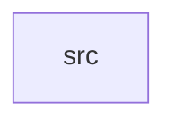

_Generated by CodeAtlas._

## Details

Owns 0 symbols across 1 file(s).

### src

Owns 21 symbols across 4 file(s).

**Related Classes/Methods:** _None_

**Source Files:**

- `crates/updater/src/commit.rs`
  - `crates.updater.src.commit.commit`
  - `crates.updater.src.commit.tests.commit_switches_active_partition`
- `crates/updater/src/transaction.rs`
  - `crates.updater.src.transaction.Transaction`
  - `crates.updater.src.transaction.Transaction.commit`
  - `crates.updater.src.transaction.Transaction.download`
  - `crates.updater.src.transaction.Transaction.fail`
  - `crates.updater.src.transaction.Transaction.new`
  - `crates.updater.src.transaction.Transaction.note`
  - `crates.updater.src.transaction.Transaction.record_snapshot`
  - `crates.updater.src.transaction.Transaction.rollback`
  - `crates.updater.src.transaction.Transaction.test_boot`
  - `crates.updater.src.transaction.Transaction.verify`
  - `crates.updater.src.transaction.TransactionState`
  - `crates.updater.src.transaction.tests.happy_path_reaches_committed`
  - `crates.updater.src.transaction.tests.power_fail_before_commit_leaves_original_boot_pointer_untouched`
  - `crates.updater.src.transaction.tests.record_snapshot_adds_to_store`
  - `crates.updater.src.transaction.tests.rollback_after_failed_boot_test_restores_previous_pointer`
  - `crates.updater.src.transaction.tests.verify_failure_stops_before_commit`
- `crates/updater/src/verify.rs`
  - `crates.updater.src.verify.tests.empty_partition_fails_verification`
  - `crates.updater.src.verify.tests.written_partition_passes_verification`
  - `crates.updater.src.verify.verify`
