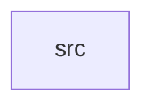

_Generated by CodeAtlas._

## Details

Owns 0 symbols across 1 file(s).

### src

Owns 62 symbols across 2 file(s).

**Related Classes/Methods:** _None_

**Source Files:**

- `crates/wayland_server/src/lib.rs`
  - `crates.wayland_server.src.lib.Output`
  - `crates.wayland_server.src.lib.PointerEvent`
  - `crates.wayland_server.src.lib.PointerEventType`
  - `crates.wayland_server.src.lib.Surface`
  - `crates.wayland_server.src.lib.WaylandCompositor`
  - `crates.wayland_server.src.lib.WaylandCompositor.attach_buffer`
  - `crates.wayland_server.src.lib.WaylandCompositor.buffer_count`
  - `crates.wayland_server.src.lib.WaylandCompositor.client_count`
  - `crates.wayland_server.src.lib.WaylandCompositor.commit_surface`
  - `crates.wayland_server.src.lib.WaylandCompositor.configure_surface`
  - `crates.wayland_server.src.lib.WaylandCompositor.connect_client`
  - `crates.wayland_server.src.lib.WaylandCompositor.create_buffer`
  - `crates.wayland_server.src.lib.WaylandCompositor.create_surface`
  - `crates.wayland_server.src.lib.WaylandCompositor.default`
  - `crates.wayland_server.src.lib.WaylandCompositor.destroy_surface`
  - `crates.wayland_server.src.lib.WaylandCompositor.disconnect_client`
  - `crates.wayland_server.src.lib.WaylandCompositor.get_buffer`
  - `crates.wayland_server.src.lib.WaylandCompositor.get_client`
  - `crates.wayland_server.src.lib.WaylandCompositor.get_focused_surface`
  - `crates.wayland_server.src.lib.WaylandCompositor.get_output`
  - `crates.wayland_server.src.lib.WaylandCompositor.get_pointer_position`
  - `crates.wayland_server.src.lib.WaylandCompositor.get_surface`
  - `crates.wayland_server.src.lib.WaylandCompositor.is_running`
  - `crates.wayland_server.src.lib.WaylandCompositor.new`
  - `crates.wayland_server.src.lib.WaylandCompositor.output_count`
  - `crates.wayland_server.src.lib.WaylandCompositor.register_output`
  - `crates.wayland_server.src.lib.WaylandCompositor.route_pointer_event`
  - `crates.wayland_server.src.lib.WaylandCompositor.set_focus`
  - `crates.wayland_server.src.lib.WaylandCompositor.start`
  - `crates.wayland_server.src.lib.WaylandCompositor.stop`
  - `crates.wayland_server.src.lib.WaylandCompositor.surface_count`
  - `crates.wayland_server.src.lib.tests.test_attach_buffer_to_surface`
  - `crates.wayland_server.src.lib.tests.test_buffer_creation`
  - `crates.wayland_server.src.lib.tests.test_client_connection`
  - `crates.wayland_server.src.lib.tests.test_client_disconnection`
  - `crates.wayland_server.src.lib.tests.test_commit_surface`
  - `crates.wayland_server.src.lib.tests.test_compositor_creation`
  - `crates.wayland_server.src.lib.tests.test_focus_management`
  - `crates.wayland_server.src.lib.tests.test_multiple_surfaces`
  - `crates.wayland_server.src.lib.tests.test_output_registration`
  - `crates.wayland_server.src.lib.tests.test_pointer_position_tracking`
  - `crates.wayland_server.src.lib.tests.test_render_pipeline`
  - `crates.wayland_server.src.lib.tests.test_start_stop`
  - `crates.wayland_server.src.lib.tests.test_surface_configuration`
  - `crates.wayland_server.src.lib.tests.test_surface_creation`
  - `crates.wayland_server.src.lib.tests.test_surface_destruction`
- `crates/wayland_server/src/transport.rs`
  - `crates.wayland_server.src.transport.Buffer`
  - `crates.wayland_server.src.transport.WaylandClient`
  - `crates.wayland_server.src.transport.WaylandTransport`
  - `crates.wayland_server.src.transport.WaylandTransport.buffer_count`
  - `crates.wayland_server.src.transport.WaylandTransport.client_count`
  - `crates.wayland_server.src.transport.WaylandTransport.connect_client`
  - `crates.wayland_server.src.transport.WaylandTransport.create_buffer`
  - `crates.wayland_server.src.transport.WaylandTransport.default`
  - `crates.wayland_server.src.transport.WaylandTransport.disconnect_client`
  - `crates.wayland_server.src.transport.WaylandTransport.get_buffer`
  - `crates.wayland_server.src.transport.WaylandTransport.get_client`
  - `crates.wayland_server.src.transport.WaylandTransport.new`
  - `crates.wayland_server.src.transport.WaylandTransport.release_buffer`
  - `crates.wayland_server.src.transport.tests.test_buffer_lifecycle`
  - `crates.wayland_server.src.transport.tests.test_client_connection`
  - `crates.wayland_server.src.transport.tests.test_client_disconnection`
